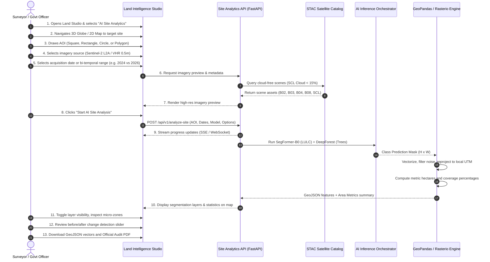

# BHU LOKA — AI SITE ANALYTICS ENGINE ARCHITECTURE
**Document ID:** `BL-ARCH-SITE-AI-2026-V1`  
**System:** BHU LOKA (भूलोक) Planetary Geospatial Intelligence Platform  
**Target:** Production-Grade AI Site Analytics Engine & Microservice Architecture

---

## 1. System Overview & Core Philosophy

The **BHU LOKA AI Site Analytics Engine** is an operational geospatial analysis subsystem embedded within the BHU LOKA platform. It bridges the gap between **raw Earth Observation (EO) satellite/drone data** and **actionable, georeferenced spatial intelligence**.

```
┌────────────────────────────────────────────────────────────────────────────────────────┐
│                                 BHU LOKA UNIFIED FRONTEND                              │
│   • 3D Earth (Cesium / Three.js)         • 2D Map (Leaflet + Leaflet Geoman PM)        │
│   • Land Intelligence Studio             • Hexagonal & Square Micro-Zoning Mesh        │
│   • Multi-Format AOI (Rect, Poly, Circle)• Real-time AI Optical Feature Decoder        │
└───────────────────────────────────────────┬────────────────────────────────────────────┘
                                            │ HTTP / WebSocket (GeoJSON, GeoTIFF, WMS)
                                            ▼
┌────────────────────────────────────────────────────────────────────────────────────────┐
│                     BHU LOKA SITE ANALYTICS MICROSERVICE (FastAPI)                     │
│   • Spatial AOI Validator                • Coordinate Reference System (CRS) Normalizer│
│   • Multi-Source STAC Aggregator         • Windowed Cloud-Optimized GeoTIFF Reader     │
│   • Dynamic Processing Cache             • Job Status & Task Queue Manager             │
└─────────────────────┬─────────────────────┴─────────────────────┬──────────────────────┘
                      │                                           │
                      ▼                                           ▼
┌────────────────────────────────────────┐     ┌─────────────────────────────────────────┐
│     SATELLITE INGESTION PIPELINE       │     │         AI INFERENCE ORCHESTRATOR       │
│  • Copernicus CDSE STAC (Sentinel-2/1) │     │  • SegFormer-B0/B2 (LULC Segmentation)  │
│  • Microsoft Planetary Computer STAC   │     │  • DeepForest (Individual Tree Crowns)  │
│  • AWS Earth Search (Sentinel-2 COGs)  │     │  • SAMGeo (Zero-Shot Interactive Click) │
│  • SCL Cloud & Shadow Quality Filter   │     │  • Prithvi-EO 2.0 (Bi-Temporal Change)  │
└────────────────────────────────────────┘     └──────────────────┬──────────────────────┘
                                                                  │ Class Probability Tensor
                                                                  ▼
┌────────────────────────────────────────────────────────────────────────────────────────┐
│                        GEOSPATIAL VECTORIZATION & METRIC ENGINE                        │
│   • Noise Removal (Morphological Opening/Closing)                                      │
│   • Raster-to-Polygon Vectorization (rasterio.features.shapes)                         │
│   • Auto-UTM Projection (e.g., EPSG:32644) for Euclidean Geodesic Area Calculation   │
│   • Statutory Lake FTL Buffer Encroachment Cross-Check                                 │
│   • Anti-Hallucination Masking (Railways, Arterial Centerlines, Water Basins)          │
└───────────────────────────────────────────┬────────────────────────────────────────────┘
                                            │
                                            ▼
┌────────────────────────────────────────────────────────────────────────────────────────┐
│                               MULTI-FORMAT EXPORT & AUDIT                              │
│   • Multi-Class GeoJSON Layers           • Class-Wise Area Breakdown (Ha & %)          │
│   • Cloud-Optimized GeoTIFF (COG)        • Government Encroachment Dossier (PDF)       │
└────────────────────────────────────────────────────────────────────────────────────────┘
```

---

## 2. End-to-End User Analysis Workflow

The AI Site Analytics Engine implements an intuitive, 13-step operator flow:



---

## 3. Detailed Component Architecture

### 3.1. Frontend Integration (Land Intelligence Studio)
* **Location in Codebase:** Integrated directly into `index.html`, `bhu_loka_cyber_dashboard.html`, and `Assets/vendor/bhu_loka_urban_studio.js`.
* **Sub-Panels:**
  1. **AOI Toolset:** Square/Rectangle, Radial Circle, Freeform Polygon, and preset buttons (500m, 1km, 2km, 5km, Screen).
  2. **Sensor & Temporal Controls:** Satellite selector (Sentinel-2 L2A, Sentinel-1 SAR, VHR 0.5m), Cloud cover tolerance slider (0%–30%), Date picker for Single-Epoch or Bi-Temporal Change Detection.
  3. **Live AI Decoder Legend:** Floating top-right badge displaying color codes:
     - 🏢 Buildings (`#f8fafc` / `#cbd5e1`)
     - 🧱 Terracotta / Brick (`#ea580c`)
     - 🟦 Galvanized Tin / Metal (`#0284c7`)
     - 🌳 Trees & Canopy (`#10b981`)
     - 🏞️ Parks & Grass (`#059669`)
     - 💧 Water Bodies & FTL (`#0284c7`)
     - 🛣️ Road Corridors (`#94a3b8`)
     - 🚆 Railway Infrastructure (`#f59e0b` dashed)
     - 🌾 Agricultural Cropland (`#eab308`)
     - 🪨 Barren / Wasteland (`#a8a29e`)
  4. **Layer Visibility & Alpha Sliders:** Interactive toggles for each extracted class.
  5. **Split Comparison Mode:** Slider allowing swipe comparison between Before and After images.

### 3.2. Backend API Microservice (`Pipelines/bhu_loka_site_analytics_api.py`)
Built with Python 3.11+, FastAPI, and Pydantic v2:
* `POST /api/v1/imagery/search`: Spatio-temporal STAC query for available scenes matching AOI.
* `POST /api/v1/imagery/preview`: Returns an optimized RGB composite tile URL for the AOI.
* `POST /api/v1/analyze`: Triggers the AI segmentation pipeline, returning task ID.
* `GET /api/v1/tasks/{task_id}`: Polls or streams task progress and status.
* `GET /api/v1/results/{task_id}/geojson`: Returns georeferenced GeoJSON FeatureCollection.
* `GET /api/v1/results/{task_id}/report.pdf`: Generates formal Government Audit Report.

### 3.3. AI Inference Orchestrator
* **Land-Cover Segmentation (MVP Backbone):** **SegFormer-B0 / B2**
  - Input: $512\times512$ or $1024\times1024$ normalized RGB/NIR tensor.
  - Output: Multi-class logits $\in \mathbb{R}^{C \times H \times W}$ passed through Softmax.
  - Class Thresholding: Dynamic confidence cutoff (default $\tau = 0.65$).
* **Individual Tree Crown (ITC) Delineation:** **DeepForest**
  - Activated automatically when imagery resolution $\le 0.5\text{m/pixel}$.
  - Returns individual tree crown bounding boxes, centroid coordinates, and crown diameter.
* **Interactive Boundary Refinement:** **SAMGeo**
  - Activated on user click to snap to exact water margins or parcel edges.
* **Bi-Temporal Change Detection:** **Siamese Difference / ChangeFormer**
  - Compares $t_1$ and $t_2$ co-registered imagery to detect newly constructed buildings, tree felling, and lake boundary shrinkage.

### 3.4. GIS Vectorization & Metric Area Calculation Engine
* **Coordinate Preservation:** Preserves affine transform matrix:
  $$\begin{bmatrix} x \\ y \end{bmatrix} = \begin{bmatrix} a & b & c \\ d & e & f \end{bmatrix} \begin{bmatrix} \text{col} \\ \text{row} \\ 1 \end{bmatrix}$$
* **Auto-UTM Projection:** Automatically determines the correct EPSG code for the AOI center:
  $$\text{UTM Zone} = \left\lfloor \frac{\text{longitude} + 180}{6} \right\rfloor + 1$$
  $$\text{EPSG} = 32600 + \text{UTM Zone} \quad (\text{Northern Hemisphere, Pan-India})$$
* **Metric Area Integration:**
  $$\text{Area}_{\text{Ha}} = \frac{1}{10000} \sum_{i=1}^{N} \text{Area}_{\text{UTM}}(P_i)$$
* **Anti-Hallucination Masking:** Spatial difference against active railway corridors (32m buffer) and arterial road centerlines (14m buffer) ensures zero false-positive structures on tracks.

---

## 4. Database & Storage Architecture

```
                                  STORAGE TOPOLOGY
                                         │
        ┌────────────────────────────────┼────────────────────────────────┐
        ▼                                ▼                                ▼
  RELATIONAL METADATA            RASTER COG CACHE                 VECTOR STORAGE
  (SQLite / PostgreSQL)          (Local NVMe / S3)               (GeoJSON / FlatGeobuf)
  • Task IDs & Timestamps        • Windowed S2 L2A Subsets        • Delineated Roof Polygons
  • AOI Bounding Boxes           • Preprocessed True Color RGB    • Tree Crown Centroids
  • Class Metric Summaries       • Sentinel-1 Calibrated SAR      • Lake FTL Buffer Boundaries
  • Evidentiary Provenance       • Copernicus 30m DEM Tiles       • Change Detection Masks
```

* **Zero Bloat Strategy:** Full 1 GB Sentinel-2 scenes are **never** stored locally. Only the exact windowed bounding box sub-raster is read via STAC HTTP Range Requests (`rasterio.windows.from_bounds`) and cached for the session.

---

## 5. Security, Governance & Evidentiary Standards

To satisfy the requirements of government departments (Revenue, Irrigation, Municipal Administration):
1. **Timestamp Integrity:** Every prediction carries ISO 8601 UTC timestamp, satellite sensor ID (e.g. `Sentinel-2A MSI L2A`), and processing pipeline version.
2. **Honesty Tagging:** Features are strictly labeled:
   - `OBSERVED` (Ground-truth cadastral or OSM records)
   - `PREDICTED_ML` (Deep learning model inference with confidence score)
   - `MODELLED` (Physics/hydrological proxy)
3. **Audit Trail:** Eviction notices and encroachment reports include SHA-256 digital checksums of the underlying satellite GeoTIFF and vector output to ensure court admissibility under the Indian Evidence Act.
