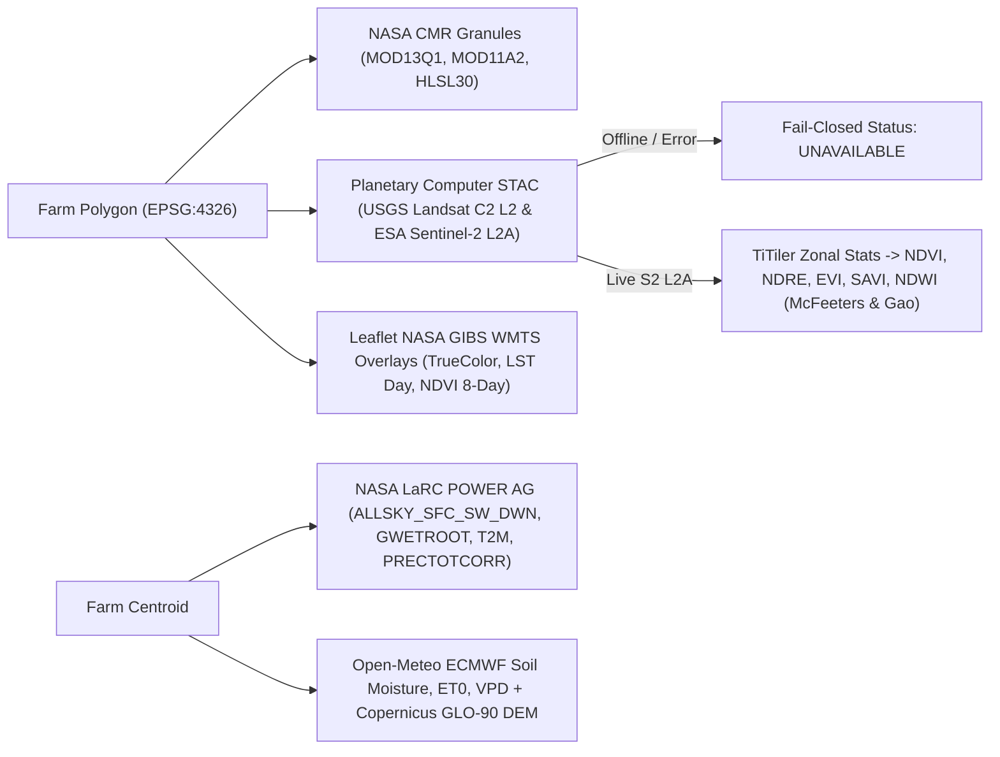

# BHU LOKA (भूलोक) — GIS and Satellite Processing Architecture for Agriculture (R0.1–R2)

**Document ID:** `BHU-ARCH-AGRI-01`  
**Team:** Prince Kumar (Project Owner, IIT Patna) | Pallav Rustogi (Project Supervisor) | Payal Priyadarshini (UI/UX Designer, IIITDM Jabalpur, 1st Semester)  

---

## 1. Architectural Pattern (Non-Breaking Vertical Slice)

The Agriculture & NASA Earth Observation backend resides in [`Pipelines/bhu_loka_agri_engine.py`](file:///c:/Users/ljpri/OneDrive/Desktop/Learning%20Pathways/LearningPathways/Bhu%20Loka%20-%20%E0%A4%AD%E0%A5%82%E0%A4%B2%E0%A5%8B%E0%A4%95/Pipelines/bhu_loka_agri_engine.py) (`APIRouter(prefix="/api/v1/agri")`), sharing `bhu_loka_india_intel.sqlite` and `RAGPipeline`.

---

## 2. Geodesic & Planar Geometry Engine

- Rejects non-closed rings, `<3` unique vertices, invalid coordinates, and non-Polygon GeoJSON.
- Projects WGS84 (`EPSG:4326`) into the centroid's fixed WGS84 UTM zone (`EPSG:32642`–`EPSG:32647` across India) using Transverse Mercator math and computes Shoelace area (`ha`, `acres`) and perimeter (`m`).
- Exports standard RFC 7946 `FeatureCollection` GeoJSON stamped with explicit ownership non-verification disclaimers.

---

## 3. Multi-Source NASA & Copernicus EO Pipeline

### Explicit Spectral Equations
- **NDVI (`10m`):** `(B08 - B04) / (B08 + B04)`
- **NDRE (`20m`):** `(B08 - B05) / (B08 + B05)`
- **EVI (`10m`):** `2.5 * (B08 - B04) / (B08 + 6.0*B04 - 7.5*B02 + 1.0)`
- **SAVI (`10m`, L=0.5):** `1.5 * (B08 - B04) / (B08 + B04 + 0.5)`
- **NDWI — Gao (1996, `20m`):** `(B08 - B11) / (B08 + B11)` (canopy water content)
- **NDWI — McFeeters (1996, `10m`):** `(B03 - B08) / (B03 + B08)` (surface / standing paddy water)

---

## 4. Farm-Aware RAG Provenance Bridge

`QueryRequest` (`api/rag.py`) accepts optional `agri_context`. `RAGPipeline.run()` appends a `live_farm_agri_context` document summarizing farm area, Sentinel-2 L2A indices, NASA LaRC POWER solar/wetness, NASA CMR / Landsat status, Open-Meteo ET0/soil moisture, and DEM drainage before `LocalSovereignGenerator` and `RagasEvaluator` (`faithfulness >= 0.70`).
