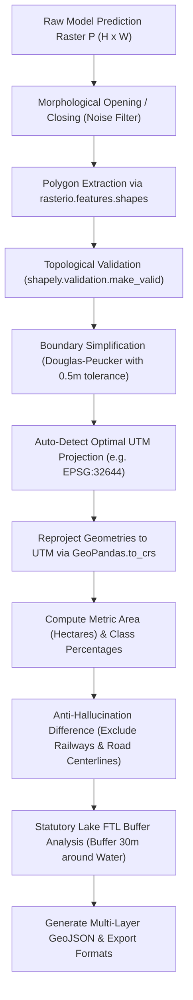

# BHU LOKA — GIS PROCESSING & VECTORIZATION WORKFLOW
**Document ID:** `BL-GIS-PROC-2026-V1`  
**System:** BHU LOKA (भूलोक) GIS Processing Engine  
**Libraries:** Rasterio, GeoPandas, Shapely, PyProj, GDAL, SciPy, NumPy

---

## 1. Overview & Pipeline Philosophy

Raw deep learning models output pixel classification arrays ($\mathbb{R}^{H \times W}$). A production-grade geospatial platform cannot display raw pixel rasters to surveyors or government officials. Outputs must be:
1. **Cleaned of Sensor Noise:** Morphological spatial filtering to remove isolated 1-pixel false positives.
2. **Vectorized into Polygons:** Extracted into valid geometric boundaries with topologically sound vertices.
3. **Reprojected to Metric Coordinate Reference Systems (CRS):** Calculated using local Universal Transverse Mercator (UTM) projections to guarantee Euclidean area accuracy without latitude distortion.
4. **Attribute Tagged:** Enriched with class name, area in hectares ($ha$), perimeter in meters ($m$), and confidence scores.



---

## 2. Noise Removal via Morphological Operations

Raw segmentation predictions frequently contain "salt-and-pepper" noise (e.g. a 1-pixel white car rooftop misclassified as a building, or a 1-pixel shadow misclassified as a pond).

* **Mathematical Formulation:**
  - **Erosion:** $(A \ominus B)(z) = \{z \in E \mid B_z \subseteq A\}$
  - **Dilation:** $(A \oplus B)(z) = \{z \in E \mid (B^s)_z \cap A \ne \emptyset\}$
  - **Morphological Opening:** $A \circ B = (A \ominus B) \oplus B$ (Removes small isolated noise spots without changing object size).
  - **Morphological Closing:** $A \bullet B = (A \oplus B) \ominus B$ (Fills tiny holes within detected rooftops and lakes).

```python
from scipy.ndimage import binary_opening, binary_closing
import numpy as np

def clean_class_mask(binary_mask: np.ndarray, min_pixel_size: int = 4) -> np.ndarray:
    """
    Cleans isolated noise from a binary class mask.
    Structure: 3x3 square structuring element.
    min_pixel_size = 4 (corresponds to 400 m² at 10m Sentinel-2 or 1 m² at 0.5m VHR).
    """
    struct = np.ones((3, 3), dtype=bool)
    opened = binary_opening(binary_mask, structure=struct)
    closed = binary_closing(opened, structure=struct)
    return closed
```

---

## 3. Vectorization & Coordinate Transformation

### 3.1. Raster-to-Vector via Rasterio Features
```python
import rasterio.features
import geopandas as gpd
from shapely.geometry import shape

def vectorize_mask_to_geopandas(cleaned_mask: np.ndarray, affine_transform, crs) -> gpd.GeoDataFrame:
    """
    Converts 2D integer raster mask into georeferenced GeoPandas GeoDataFrame.
    """
    shapes_gen = rasterio.features.shapes(
        cleaned_mask.astype(np.int32),
        mask=(cleaned_mask > 0),
        transform=affine_transform
    )
    
    records = []
    for geom_dict, class_id in shapes_gen:
        poly = shape(geom_dict)
        if poly.is_valid and poly.area > 0:
            records.append({"geometry": poly, "class_id": int(class_id)})
            
    gdf = gpd.GeoDataFrame(records, crs=crs)
    return gdf
```

### 3.2. Universal Transverse Mercator (UTM) Auto-Projection
In standard geographic WGS84 (`EPSG:4326`), coordinates are stored in degrees. Calculating polygon areas directly in degrees yields severe distortion because 1 degree of longitude varies from $111.32\text{ km}$ at the equator to $0\text{ km}$ at the poles:
$$\Delta x = \Delta \lambda \cdot R \cos(\phi), \quad \Delta y = \Delta \phi \cdot R$$

To achieve sub-percent metric accuracy, the engine automatically calculates the local UTM zone:
$$\text{UTM Zone} = \left\lfloor \frac{\text{longitude} + 180}{6} \right\rfloor + 1$$
$$\text{EPSG Code} = 32600 + \text{UTM Zone} \quad (\text{Northern Hemisphere})$$

* **Pan-India UTM Coverage:**
  - Zone 42N (`EPSG:32642`): Western Gujarat, Rajasthan
  - Zone 43N (`EPSG:32643`): Maharashtra, Karnataka, Western MP
  - Zone 44N (`EPSG:32644`): Telangana, Andhra Pradesh, Central MP, Eastern UP
  - Zone 45N (`EPSG:32645`): Bihar (Patna), West Bengal, Odisha, Jharkhand
  - Zone 46N (`EPSG:32646`): Assam, Northeast India

```python
import pyproj

def get_utm_crs(lon: float, lat: float) -> str:
    zone = int((lon + 180) // 6) + 1
    return f"EPSG:326{zone:02d}"

def calculate_metric_areas(gdf: gpd.GeoDataFrame, center_lon: float, center_lat: float) -> gpd.GeoDataFrame:
    utm_crs = get_utm_crs(center_lon, center_lat)
    # Reproject to local UTM
    gdf_utm = gdf.to_crs(utm_crs)
    
    # Calculate exact Euclidean area in square meters and hectares
    gdf_utm["area_m2"] = gdf_utm.geometry.area
    gdf_utm["area_ha"] = gdf_utm["area_m2"] / 10000.0
    gdf_utm["perimeter_m"] = gdf_utm.geometry.length
    
    # Reproject back to WGS84 for GeoJSON web map delivery
    gdf_wgs84 = gdf_utm.to_crs("EPSG:4326")
    gdf_wgs84["area_ha"] = gdf_utm["area_ha"]
    gdf_wgs84["area_m2"] = gdf_utm["area_m2"]
    
    return gdf_wgs84
```

---

## 4. Statutory Lake FTL Buffer & Anti-Collision Analysis

### 4.1. Lake Full Tank Level (FTL) 30m Buffer
In compliance with Government of Telangana (WALTA Act 2002) and Central Water Commission norms:
* A statutory **30-meter non-construction buffer zone** is established around every delineated lake and water body:
$$\mathcal{B}_{\text{FTL}} = \bigcup_{w \in \mathcal{W}} \text{buffer}(w, 30.0\text{ meters})$$
* **Encroachment Detection:**
$$\mathcal{E} = \mathcal{P}_{\text{Buildings}} \cap \mathcal{B}_{\text{FTL}}$$
Any detected structure falling within $\mathcal{E}$ is flagged with:
`status: "ILLEGAL_LAKE_FTL_ENCROACHMENT"` (Red highlighted boundary).

### 4.2. Railway Corridor Anti-Collision
To prevent artificial buildings from hallucinating over train tracks (observed in Patna Junction and railway yards):
* Railway lines from OSM/infrastructure are buffered by **32 meters**:
$$\mathcal{B}_{\text{Rail}} = \bigcup_{r \in \mathcal{R}} \text{buffer}(r, 32.0\text{ meters})$$
* Any candidate building $b$ intersecting $\mathcal{B}_{\text{Rail}}$ is discarded:
$$\mathcal{P}_{\text{Clean}} = \mathcal{P}_{\text{Buildings}} \setminus \mathcal{B}_{\text{Rail}}$$

---

## 5. Class Area Summary Table

```python
def generate_class_summary(gdf: gpd.GeoDataFrame, aoi_total_ha: float) -> dict:
    """
    Computes class-wise total hectares and percentage of AOI.
    """
    summary = {}
    grouped = gdf.groupby("class_name")["area_ha"].sum()
    
    for class_name, ha in grouped.items():
        pct = (ha / max(0.01, aoi_total_ha)) * 100.0
        summary[class_name] = {
            "area_ha": float(np.round(ha, 2)),
            "area_km2": float(np.round(ha / 100.0, 3)),
            "coverage_pct": float(np.round(pct, 1))
        }
    return summary
```
