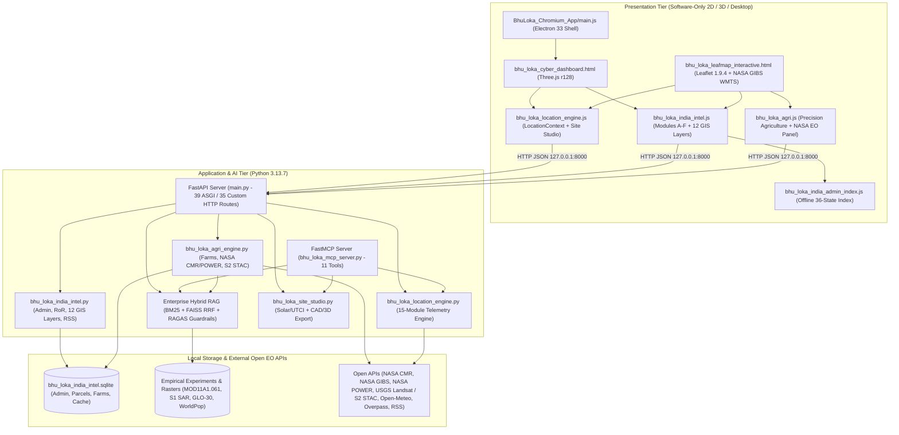

# BHU LOKA (भूलोक) — High-Level Architecture Design (HLD, R0 / R0.1)

**Document ID:** `BHU-HLD-R0`  
**Team:** Prince Kumar (Project Owner, IIT Patna) | Pallav Rustogi (Project Supervisor) | Payal Priyadarshini (UI/UX Designer, IIITDM Jabalpur, 1st Semester)  
**Scope:** Software-Only Scientific Geospatial Platform  

---

## 1. System Topology

---

## 2. Software-Only Runtime Boundaries

- **Web & API Execution:** `uvicorn main:app` serves `35` custom HTTP routes on `127.0.0.1:8000` (all R0 routes plus `/api/v1/agri/*`).
- **Desktop & MCP Execution:** `BhuLoka_Chromium_App/main.js` wraps the 3D HUD; `bhu_loka_mcp_server.py` exposes `11` FastMCP tools.
- **No Hardware/IoT Tier:** Physical IoT sensors, wearables, and hardware firmware are explicitly out of current scope.
