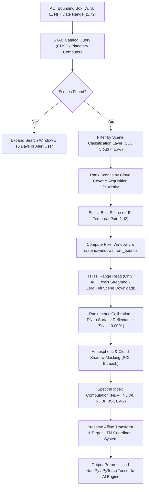

# BHU LOKA — SATELLITE DATA PIPELINE & PREPROCESSING SPECIFICATION
**Document ID:** `BL-EO-PIPE-2026-V1`  
**System:** BHU LOKA (भूलोक) Earth Observation Ingestion Engine  
**Standards:** STAC (SpatioTemporal Asset Catalog v1.0.0), Cloud-Optimized GeoTIFF (COG), EPSG WGS84 / UTM

---

## 1. Multi-Sensor Data Sources

The BHU LOKA Satellite Data Pipeline ingests multi-spectral, synthetic aperture radar (SAR), elevation, and high-resolution optical imagery through legally open, enterprise-grade STAC APIs:

```
                                  DATA SOURCE INGESTION MATRIX
                                                │
         ┌──────────────────────────────┬───────┴──────────────────────┬──────────────────────────────┐
         ▼                              ▼                              ▼                              ▼
  COPERNICUS SENTINEL-2           COPERNICUS SENTINEL-1          LANDSAT-8 / LANDSAT-9          OPEN VHR SATELLITE
  • Level-2A Surface Reflectance  • Level-1 GRD (Ground Range)   • Level-2 OLI/TIRS Surface     • Esri World Imagery (0.5m)
  • 10m/20m Multi-Spectral        • C-Band SAR (5.405 GHz)         Reflectance (30m)            • Google Satellite (0.5m)
  • 13 Bands (RGB, NIR, RedEdge,  • Dual Polarisation (VV + VH)  • 11 Bands (Coastal to TIR)    • Airbus / Maxar Open Data
    SWIR1, SWIR2)                 • All-Weather / Day & Night    • 100m Thermal Resampled       • Local Drone Orthomosaics
  • Revisit: 5 Days               • Revisit: 6–12 Days           • Revisit: 16 Days (8 combined)• On-Demand AOI
```

### 1.1. Ingestion Endpoints (Zero API Cost Tier)
1. **Copernicus Data Space Ecosystem (CDSE):**
   - STAC Endpoint: `https://catalogue.dataspace.copernicus.eu/stac`
   - OData / S3 Compatible API for Sentinel-1 & Sentinel-2 raw SAFE and COG assets.
2. **Microsoft Planetary Computer:**
   - STAC Endpoint: `https://planetarycomputer.microsoft.com/api/stac/v1`
   - Collections: `sentinel-2-l2a`, `sentinel-1-grd`, `landsat-c2-l2`, `cop-dem-glo-30`.
   - Feature: SAS token signing enables direct windowed HTTP streaming of Cloud-Optimized GeoTIFFs (COGs).
3. **AWS Earth Search (Element 84):**
   - STAC Endpoint: `https://earth-search.aws.element84.com/v1`
   - Collections: `sentinel-2-l2a-cogs` (Free, zero-authentication public AWS S3 requester-pays bucket).

---

## 2. Satellite Ingestion Workflow



---

## 3. Band Selection & Radiometric Calibration

### 3.1. Sentinel-2 L2A Processing
To convert Digital Numbers ($\text{DN}$) to Top-Of-Canopy Surface Reflectance ($\rho$):
$$\rho = \frac{\text{DN} + \text{BOA\_ADD\_OFFSET}}{10000.0}$$
*(Where $\text{BOA\_ADD\_OFFSET} = -1000$ for baseline processing $\ge 04.00$, or $0$ for earlier baselines).*

* **Bands Selected for Site Analytics:**
  - **Band 2 (Blue, 490 nm, 10m):** Water body contrast, urban atmospheric scattering.
  - **Band 3 (Green, 560 nm, 10m):** Green vegetation peak, NDWI computation.
  - **Band 4 (Red, 665 nm, 10m):** Chlorophyll absorption, NDVI computation, terracotta roofs.
  - **Band 8 (Broad NIR, 842 nm, 10m):** Biomass density, vegetation cellular reflectance.
  - **Band 11 (SWIR-1, 1610 nm, 20m):** Built-up imperviousness (NDBI), moisture stress, soil dryness.
  - **Band 12 (SWIR-2, 2190 nm, 20m):** Burn scars, mineral identification, dry clay lake beds.
  - **SCL (Scene Classification Layer, 20m):** Cloud, cloud shadow, water, snow/ice bitmask.

### 3.2. Sentinel-1 SAR Processing
SAR penetrates monsoonal clouds, smoke, and haze. The radar backscatter coefficient $\sigma^0$ in decibels ($\text{dB}$) is derived from Level-1 Ground Range Detected (GRD) amplitude:
$$\sigma^0 (\text{dB}) = 10 \cdot \log_{10} \left( \text{DN}^2 \right) - K_{\text{cal}}$$
* **Physical Thresholds for India:**
  - **Open Water / Smooth Surface:** $\sigma^0_{\text{VV}} < -18.0\text{ dB}$ (Specular reflection away from radar antenna).
  - **Urban Double-Bounce (Corner Reflectors):** $\sigma^0_{\text{VV}} > -6.0\text{ dB}$ (Strong return between vertical wall and horizontal asphalt/ground).
  - **Agricultural / Vegetation Volume Scattering:** $-14.0\text{ dB} \le \sigma^0_{\text{VV}} \le -8.0\text{ dB}$, $\text{VH/VV ratio} > 0.25$.

---

## 4. Band Indices & Formulas

| Index | Formula | Physical Interpretation | Threshold for Indian Terrain |
| :--- | :--- | :--- | :--- |
| **NDVI** (Normalized Difference Vegetation Index) | $\frac{\text{B08} - \text{B04}}{\text{B08} + \text{B04}}$ | Photosynthetic active biomass / Green canopy | $> 0.40$: Dense Greenery<br>$0.20 - 0.40$: Sparse / Scrub<br>$< 0.10$: Built / Water |
| **NDWI** (Normalized Difference Water Index - McFeeters) | $\frac{\text{B03} - \text{B08}}{\text{B03} + \text{B08}}$ | Open surface water bodies | $> 0.05$: Water / Pond<br>$\le 0.00$: Non-water |
| **MNDWI** (Modified NDWI - Xu) | $\frac{\text{B03} - \text{B11}}{\text{B03} + \text{B11}}$ | Water bodies in urban built-up environments | $> 0.00$: Water (suppresses built-up noise) |
| **NDBI** (Normalized Difference Built-Up Index) | $\frac{\text{B11} - \text{B08}}{\text{B11} + \text{B08}}$ | Impervious concrete, asphalt, settlement density | $> 0.05$: Built-up / Concrete |
| **BSI** (Bare Soil Index) | $\frac{(\text{B11} + \text{B04}) - (\text{B08} + \text{B02})}{(\text{B11} + \text{B04}) + (\text{B08} + \text{B02})}$ | Fallow agricultural soil, barren wasteland, excavation | $> 0.10$: Barren / Exposed Soil |

---

## 5. Windowed Read Implementation (Zero-Bloat Ingestion)

To prevent downloading entire 1 GB satellite scenes, the ingestion service executes **HTTP Range Requests** directly over Cloud-Optimized GeoTIFFs (COGs) using `rasterio`:

```python
import rasterio
from rasterio.windows import from_bounds
import pyproj

def stream_aoi_band(cog_url: str, bounds_wgs84: tuple) -> tuple:
    """
    Streams ONLY the target AOI bounding box pixels over HTTP Range requests.
    bounds_wgs84: (west, south, east, north)
    """
    west, south, east, north = bounds_wgs84
    with rasterio.open(cog_url) as src:
        # Reproject WGS84 bounding box to native raster CRS (e.g. UTM Zone 44N)
        transformer = pyproj.Transformer.from_crs("EPSG:4326", src.crs, always_xy=True)
        min_x, min_y = transformer.transform(west, south)
        max_x, max_y = transformer.transform(east, north)
        
        # Calculate sub-pixel read window
        window = from_bounds(min_x, min_y, max_x, max_y, transform=src.transform)
        
        # Stream windowed raster data
        data = src.read(1, window=window)
        win_transform = rasterio.windows.transform(window, src.transform)
        
        return data, win_transform, src.crs
```

---

## 6. Scientific Data Integrity Protocol

1. **Anti-Screenshot Mandate:** The ingestion engine **strictly prohibits** using client map canvas screenshots as input to deep learning models. Screenshots lack calibrated radiometric reflectance, multi-spectral bands (NIR/SWIR), and native affine spatial metadata.
2. **CRS Preservation:** Every output raster retains its original projection and affine transform matrix ($a, b, c, d, e, f$) ensuring spatial precision within $\pm 0.5\text{ meters}$.
3. **Cloud Mask Quality Filter:** Pixels tagged as cloud (SCL 8, 9) or cloud shadow (SCL 3) are automatically masked out and assigned `NODATA` (value `255`), preventing cloud glare from being misclassified as concrete roofs or water shadows from being misclassified as lakes.
