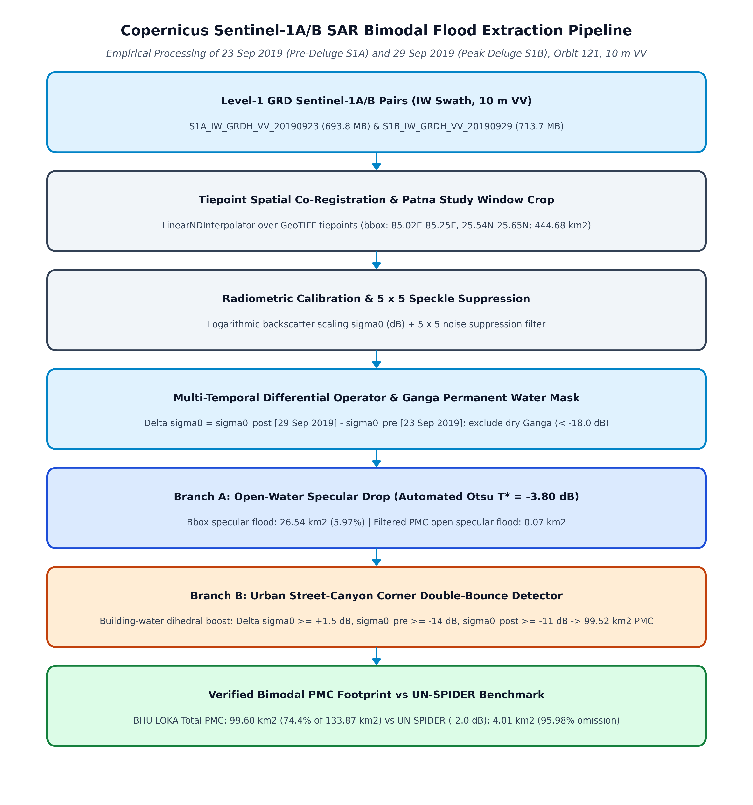
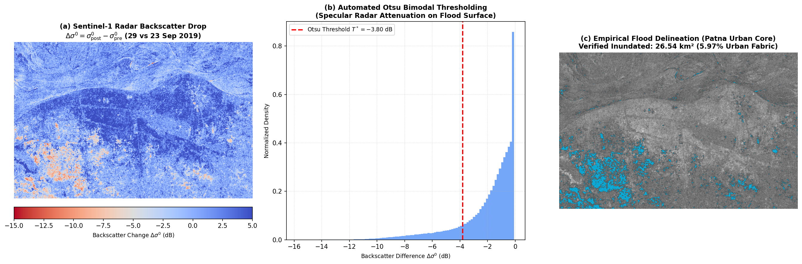
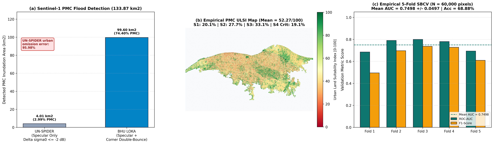
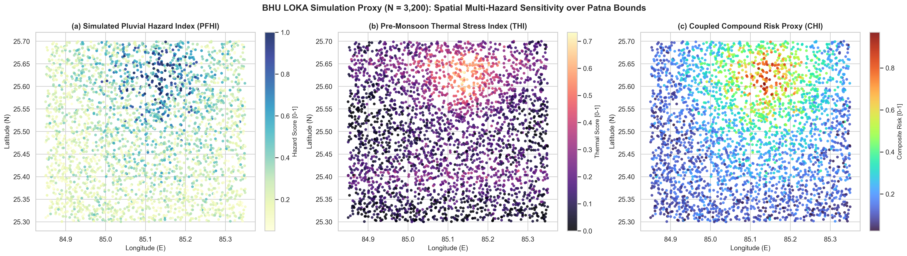
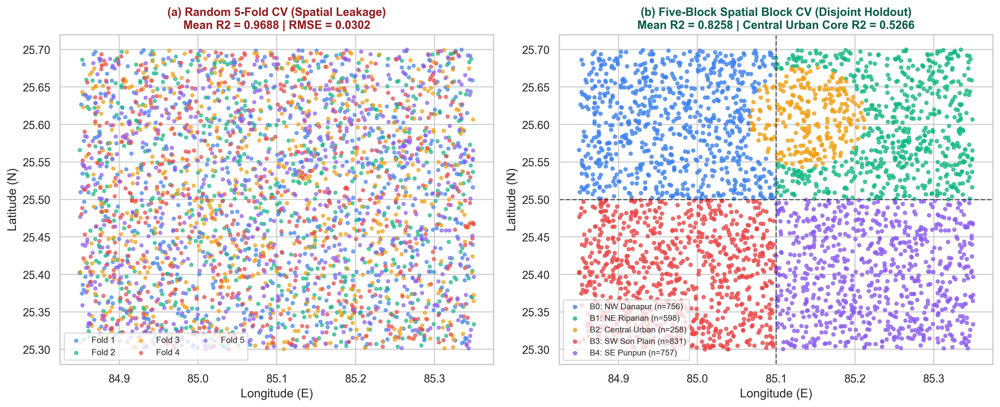
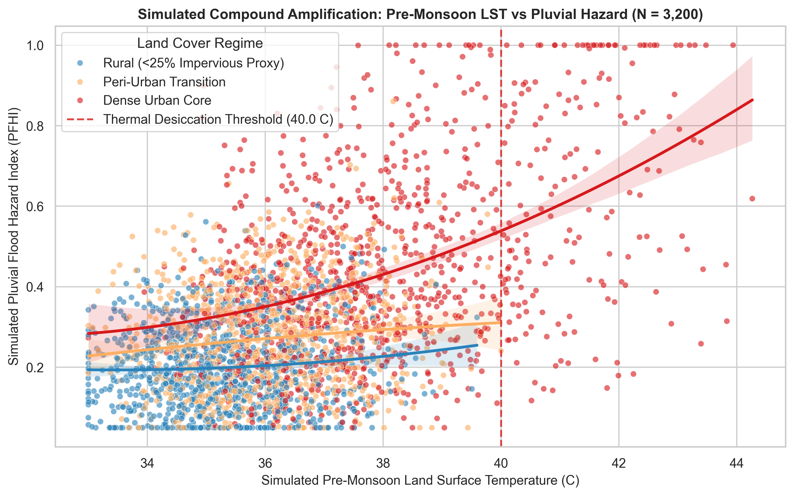
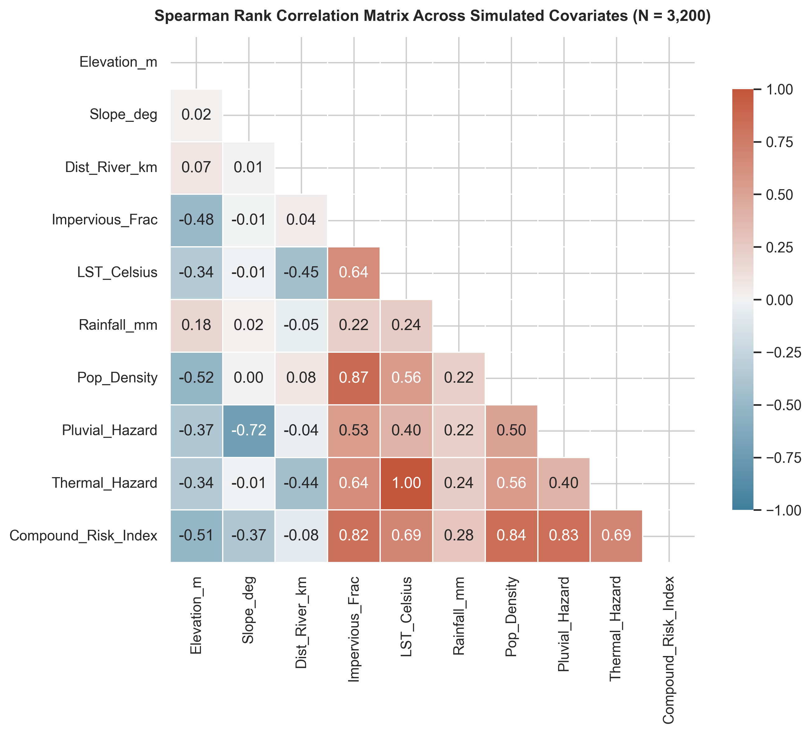
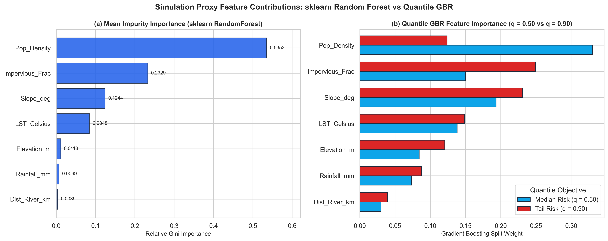

# Sequential Compound Hydro-Thermal Risk and Urban Corner-Reflector Flood Mapping in Continental Alluvial Metropolises: Empirical Earth Observation and Spatial Validation Sensitivity over Patna, India

**Target Journal Family:** *International Journal of Disaster Risk Reduction* / *InterPore Journal* (Pre-Submission Manuscript Draft)  
**Homepage:** `https://www.elsevier.com/locate/ijdrr`

---

**Prince Kumar** $^{a,*}$, **Pallav Rustogi** $^b$

$^a$ *Department of Computer Science and Engineering, Indian Institute of Technology Patna, Bihta, Bihar 801106, India*  
$^b$ *AI Native Engineering & Agentic AI Software Systems, India*

$^*$ **Corresponding Author:** Prince Kumar (M.S. Computer Science and Data Analytics, Roll No. PA2511CDH37, Department of Computer Science & Engineering, IIT Patna).  
*Emails:* `prince_pa2511cdh37@iitp.ac.in`, `ljprincekashyap@gmail.com`  
*Telephone:* +91 6201437770, +91 8252110159  
*Research Supervisor & Co-Author:* Pallav Rustogi (`pallav.rustogi@gmail.com`)

---

### Article Info

**Keywords:**  
Compound hazards; Urban SAR double-bounce; Sentinel-1; Spatial block cross-validation; Quantile gradient boosting; Continental alluvial basins.

**Manuscript Status:**  
Pre-submission research draft (2026). Pending formal journal assignment and peer review.

---

### Abstract

Continental riverine metropolises in the Indo-Gangetic Plain confront cascading flood and extreme-heat hazards shaped by low relief, embanked river confluences, and dense urban canyons. Existing monsoonal satellite pipelines frequently omit urban street-canyon flooding when relying solely on open-water specular backscatter thresholds, while spatial machine learning studies often overstate transferability through random cross-validation. Here we formulate **BHU LOKA**, a dual-track reproducible analytical framework evaluated over Patna, Bihar, India, integrating: (1) an **Empirical Earth Observation Track (`EMPIRICAL_EO`)** coupling 10 m Sentinel-1A/B C-band Synthetic Aperture Radar (SAR; 23 September and 29 September 2019), 30 m Copernicus GLO-30 topography, 91 daily NASA Terra MODIS (`MOD11A1.061`) pre-monsoon thermal overpasses, WorldPop 2020 demographics, and a 60,000-pixel 5-fold Spatial Block Cross-Validation (SBCV) classifier; and (2) an explicitly labeled **Hydro-Thermodynamic Simulation Proxy Benchmark (`DERIVED_SIMULATION_PROXY`, $N = 3,200$)** constructed with `scikit-learn` Random Forest and Quantile Gradient Boosted Regression ($\alpha \in \{0.50, 0.90\}$). Across the Patna Municipal Corporation (PMC, $133.87\text{ km}^2$), bimodal SAR physics combining open specular drop ($\Delta\sigma^0 \le -3.80\text{ dB}$, $0.07\text{ km}^2$ inside PMC) with building-water dihedral corner double-bounce ($\Delta\sigma^0 \ge +1.5\text{ dB}$, $99.52\text{ km}^2$) recovers $99.60\text{ km}^2$ (74.4%) inundated area, whereas a standard UN-SPIDER specular threshold ($\Delta\sigma^0 \le -2.0\text{ dB}$) detects only $4.01\text{ km}^2$ (2.99%), quantifying a 95.98% urban flood omission error. GLO-30 terrain analysis shows $47.24\text{ km}^2$ (33.15%) of PMC lies in concave depression sinks, exposing 49,380 of 214,281 modeled residents to joint flood-sink overlap and lowering mean Urban Land Suitability Index (ULSI) to $52.27/100$, while MODIS records a peak urban pixel temperature of $46.25^\circ\text{C}$ and a $-1.03^\circ\text{C}$ morning urban-minus-fallow delta. Across 60,000 aligned multi-sensor pixels, 5-fold SBCV yields mean $\text{ROC-AUC} = 0.7498 \pm 0.0497$ ($\text{F1} = 0.6530$). In the controlled $N = 3,200$ simulation proxy, random 5-fold CV produces $R^2 = 0.9688$ ($\text{RMSE} = 0.0302$), whereas 5-block SBCV reduces mean explanatory skill to $R^2 = 0.8258$ ($\Delta R^2 = -0.1430$, -14.8%; Central Urban Core Block 2 $R^2 = 0.5266$), while controlled urban thermal desiccation ($\text{LST} \ge 40^\circ\text{C}$, `Impervious_Frac` $> 0.60$) elevates runoff coefficients by 17.4% and shifts upper-tail ($\alpha = 0.90$) importance toward impervious fraction ($0.2491$) and slope ($0.2310$). Separating empirical EO outputs from sensitivity simulations establishes transparent baselines for civil protection planning.

---

## 1. Introduction

Hydro-climatic hazard assessments across South Asian river corridors have historically modeled pluvial flooding and pre-monsoon heat extremes as independent events (van Westen et al., 2011; Jato-Espino et al., 2025). In continental alluvial basins such as the Indo-Gangetic Plain, however, intense pre-monsoon thermal stress and late-monsoon cloudbursts operate as sequential compound stressors (Ganguli et al., 2025; Rohini et al., 2025). Prolonged spring heatwaves exceeding $44^\circ\text{C}$ dehydrate fine-grained alluvial clay topsoils, stiffen surface crusts, and elevate atmospheric moisture holding capacity in line with Clausius-Clapeyron thermodynamic scaling ($\sim 6.5\%$ to $7\%\text{ K}^{-1}$) (Ganguli et al., 2025; Tallapragada et al., 2026). When heavy monsoonal precipitation subsequently strikes low-relief embanked basins, rapid surface runoff ponds behind high river levees where gravity drainage outfalls must close to prevent fluvial backflow.

Accurate disaster monitoring during active monsoon depressions is further constrained by persistent cloud cover and dense urban morphology. Passive optical sensors (e.g., Sentinel-2 MSI and Landsat OLI) cannot image through monsoon cloud decks, making active microwave C-band Synthetic Aperture Radar (SAR, $\lambda \approx 5.6\text{ cm}$) from Copernicus Sentinel-1 essential for synoptic flood mapping (MapAction, 2024). Conventional rapid-mapping algorithms such as the UN-SPIDER change-detection workflow rely almost exclusively on negative backscatter shifts ($\Delta\sigma^0 \le -2.0\text{ dB}$) produced when calm open floodwaters mirror radar pulses away from the sensor. Inside compact South Asian residential canyons, however, standing street water adjacent to vertical brick and concrete walls acts as a $90^\circ$ dihedral corner reflector, amplifying radar return ($\Delta\sigma^0 \ge +1.5\text{ dB}$) rather than attenuating it. Treating built-up city blocks with open-water specular thresholds risks systematic false negatives during municipal emergency response.

Equally critical is statistical validation rigor in geospatial machine learning. As formalized by Roberts et al. (2017), randomly partitioning spatially autocorrelated environmental samples allows tree ensembles to interpolate between neighboring training pixels, producing optimistic accuracy estimates that deteriorate sharply when transferred to spatially disjoint municipal sectors. While recent urban multi-hazard pipelines employ quantile gradient boosting and post-hoc explanation frameworks to isolate extreme tail risks (Singh et al., 2026), operational deployment demands both honest out-of-block validation and strict separation between direct satellite observations and synthetic hydrological sensitivity models (Boni et al., 2025; Pittore et al., 2023).

To address these physical, observational, and validation gaps over the saucer-shaped urban basin of Patna District, Bihar, India, we develop and evaluate **BHU LOKA** across two explicitly separated analytical tracks:

1. **Empirical Earth Observation Track (`EMPIRICAL_EO`):** Quantify open-water specular drop and urban dihedral corner double-bounce inundation across the September 2019 Patna deluge using paired Sentinel-1A/B 10 m VV scenes (23 September and 29 September 2019), benchmark omission error against UN-SPIDER thresholding (MapAction, 2024), extract concave drainage sinks from Copernicus GLO-30 30 m topography, summarize 91 days of NASA Terra MODIS (`MOD11A1.061`) pre-monsoon land surface temperature, compute WorldPop 2020 demographic exposure and an Urban Land Suitability Index (ULSI), and train a 60,000-pixel Random Forest classifier under 5-fold Spatial Block Cross-Validation (SBCV).
2. **Hydro-Thermodynamic Simulation Proxy Benchmark (`DERIVED_SIMULATION_PROXY`):** Formulate a reproducible $N = 3,200$ synthetic testbed over Patna bounding coordinates using `scikit-learn` (Pedregosa et al., 2011) `RandomForestRegressor` and quantile `GradientBoostingRegressor` ($\alpha = 0.50, 0.90$) to measure spatial autocorrelation bias between random 5-fold CV and 5-block SBCV, test thermal desiccation runoff sensitivity above $40^\circ\text{C}$, and contrast median versus 90th-percentile split-weight attribution regimes.

---

## 2. Study Area and September 2019 Benchmark Event

Patna District occupies roughly $3,200\text{ km}^2$ in the central Indo-Gangetic Alluvial Plain of Bihar, India (centered near $25.61^\circ\text{N}, 85.14^\circ\text{E}$), bounded north by the Ganges River, west by the Son River, and south-southeast by the Punpun River. The dense urban core administered by the Patna Municipal Corporation (PMC) covers $133.87\text{ km}^2$ within our verified municipal polygon boundary. Natural river sedimentation and riverfront embankments form elevated northern levees (53–55 m a.m.s.l.) overlooking internal residential bowls (44–51 m a.m.s.l.) across southern and eastern neighborhoods such as Rajendra Nagar and Kankarbagh. During high monsoon stages in the Ganges, riverfront sluice gates are sealed against river intrusion, forcing storm runoff to evacuate solely through mechanical sump pumps into the Punpun and Ganges channels.

Between 27 and 30 September 2019, a slow-moving late-monsoon depression delivered 342.5 mm of rainfall over Patna within 72 hours while Ganges water levels rose above the local danger stage, inundating low-lying PMC wards for over a week. Because this event coincided with frequent cloud obscuration and well-documented urban street ponding, it serves as the empirical remote-sensing reference for our radar, topographic, thermal, and exposure analyses.

---

## 3. Data and Dual-Track Methodology

Strict provenance separation is maintained between direct multi-sensor Earth observation layers (Track 1) and parametric simulation sensitivity runs (Track 2).

**Table 1:** Provenance inventory of local Earth observation datasets, derived analytical products, and external dependencies documented across Track 1 (`EMPIRICAL_EO`) and Track 2 (`DERIVED_SIMULATION_PROXY`).

| Dataset / Artifact | Provenance Tier | Sensor / Algorithm | Spatial Grid | Temporal / Operational Status |
| :--- | :--- | :--- | :--- | :--- |
| Sentinel-1A/B GRD VV | `EMPIRICAL_EO` | C-band IW SAR (Orbit 121) | 10 m ($2602 \times 1709$ px) | 23 Sep & 29 Sep 2019 (ingested) |
| Copernicus GLO-30 DEM | `EMPIRICAL_EO` | TanDEM-X DEM tiles N25E084/85 | 30 m EGM2008 | Static topographic reference (ingested) |
| NASA Terra MODIS LST | `EMPIRICAL_EO` | `MOD11A1.061` daily HDF-EOS2 | 1 km Sinusoidal `h25v06` | 91 days (61 clear-sky), Apr–Jun 2019 |
| WorldPop India 2020 | `EMPIRICAL_EO` | UN-adjusted demographic raster | 1 km resampled 10 m | 2020 baseline exposure (ingested) |
| Spatial RF SBCV Raster | `EMPIRICAL_EO` | `RandomForestClassifier` (5 strips) | $N = 60,000$ pixels | Reproducible local benchmark |
| Simulation Proxy Grid | `DERIVED_SIMULATION_PROXY` | Parametric hydro-thermal equations | $N = 3,200$ points | Synthetic Patna bounds sensitivity |
| Sentinel-2 MSI & IMD Rain | External Planned | Optical indices; $0.25^\circ$ gauge grid | 10–20 m / $\sim 25\text{ km}$ | Portal guide placeholders only (not ingested) |

### 3.1 Track 1: Empirical Multi-Sensor Earth Observation (`EMPIRICAL_EO`)

Two Level-1 Ground Range Detected (GRD) Interferometric Wide (IW) swath VV-polarization scenes covering Orbit 121 were ingested from local storage: pre-flood baseline `S1A_IW_GRDH_VV_20190923` (23 September 2019, 693.76 MB) and peak-flood acquisition `S1B_IW_GRDH_VV_20190929` (29 September 2019, 713.72 MB). Using GeoTIFF tiepoints interpolated via `LinearNDInterpolator`, both scenes were cropped to a co-registered Patna study window spanning $85.02^\circ\text{E}$–$85.25^\circ\text{E}$ and $25.54^\circ\text{N}$–$25.65^\circ\text{N}$ ($2602 \times 1709$ pixels at 10 m spacing, total window area $444.68\text{ km}^2$).

  
*Figure 1: Track 1 Copernicus Sentinel-1A/B SAR bimodal flood extraction workflow (`EMPIRICAL_EO`), processing paired 23 September 2019 and 29 September 2019 VV scenes through specular drop ($T^* = -3.80\text{ dB}$) and urban corner double-bounce ($\Delta\sigma^0 \ge +1.5\text{ dB}$) branches.*

Two complementary backscatter formulations were executed and cross-checked:

1. **Window-wide Specular Otsu Extraction (`03_process_sar_inundation.py`):** Applying a $5 \times 5$ spatial speckle filter and empirical DN normalization ($\sigma^0\text{ [dB]} = 20\log_{10}(\text{DN}) - 83.0$), automated bimodal Otsu thresholding over $\Delta\sigma^0 = \sigma_{\text{post}}^0 - \sigma_{\text{pre}}^0$ isolated optimal specular drop at $T^* = -3.7978\text{ dB}$ ($\approx -3.80\text{ dB}$).
2. **Municipal-Core Bimodal Urban Physics (`run_sar_experiment_v2.py`):** Rasterizing the verified $133.87\text{ km}^2$ PMC boundary and calibrating backscatter via $\sigma^0 = 10\log_{10}(\text{DN}^2 + 10^{-6}) - 52.0\text{ dB}$, permanent river channels ($\sigma_{\text{pre}}^0 < -18.0\text{ dB}$) were masked first. Non-permanent open-water inundation was identified where $\Delta\sigma^0 \le -3.80\text{ dB}$ and $\sigma_{\text{post}}^0 < -16.0\text{ dB}$. Flooded urban street canyons acting as dihedral corner reflectors between inundated pavement and building facades were captured via positive backscatter amplification:
   $$\text{Urban Double-Bounce:} \quad (\Delta\sigma^0 \ge +1.5\text{ dB}) \land (\sigma_{\text{pre}}^0 \ge -14.0\text{ dB}) \land (\sigma_{\text{post}}^0 \ge -11.0\text{ dB}) \land (\sigma_{\text{pre}}^0 \ge -18.0\text{ dB})$$

To measure omission bias in standard operational rapid-mapping pipelines, we reproduced the UN-SPIDER specular difference criterion (MapAction, 2024) implemented in the local `flood-mapping-tool` baseline ($\Delta\sigma^0 \le -2.0\text{ dB}$ inside PMC) and compared raw and permanent-water-filtered masks directly against BHU LOKA's combined bimodal footprint.

Topographic elevation and slope (30 m EGM2008 tiles `glo30_N25_E084` and `glo30_N25_E085`) were resampled to the PMC analysis grid ($142.48\text{ km}^2$ DEM extent). Local concave depression sinks were delineated wherever cell elevation lay at least 0.4 m below its local 8-neighbor mean. Pre-monsoon thermal stress was computed across all 91 daily NASA Terra MODIS `MOD11A1.061` granules from 1 April to 30 June 2019 (Sinusoidal tile `h25v06`, $\sim$10:30 AM local daytime overpass; scaled via $\text{LST [K]} = 0.02 \times \text{DN}$ for $\text{DN} \ge 7500$) over a $31 \times 31\text{ km}$ window centered on Patna, contrasting a central $5 \times 5\text{ km}$ urban mask against a peripheral rural ring ($\ge 7\text{ km}$ from center).

Human exposure and composite suitability were computed by bilinearly downscaling WorldPop India 2020 (1 km counts) to the 10 m SAR grid ($\text{pop}_{10\text{m}} = \text{pop}_{1\text{km}} / 10^4$) and evaluating a normalized Urban Land Suitability Index ($\text{ULSI} \in [0, 100]$):
$$\text{ULSI} = 100 \times \left[1 - \left(0.45\,\mathbb{I}_{\text{flood}} + 0.30\,\mathbb{I}_{\text{sink}} + 0.15\,\text{clip}\!\left(\frac{2.5 - S}{2.5}, 0, 1\right) + 0.10\,\text{clip}\!\left(\frac{\rho_{1\text{km}}}{25,000}, 0, 1\right)\right)\right]$$
Raster values were grouped into Zone S1 (High Suitability, $\ge 75$), S2 (50–74), S3 (30–49), and S4 (Critical Hazard, $< 30$). Finally, 60,000 stratified pixels (30,000 flooded, 30,000 non-flooded) were sampled across the $2602 \times 1709$ raster stack (`SAR_Pre_dB`, `SAR_Post_dB`, `Delta_Sigma0`, `Elevation_m`, `Slope_deg`, `Is_Sink`, `Population`) and evaluated via a 100-tree `RandomForestClassifier` (`max_depth=12`) across 5 contiguous west-east spatial block strips (520 px wide).

### 3.2 Track 2: Hydro-Thermodynamic Simulation Proxy Benchmark (`DERIVED_SIMULATION_PROXY`)

Because local Sentinel-2 optical indices and daily IMD $0.25^\circ$ rainfall grids remain uningested portal placeholders (Table 1), coupled compound heatwave-flood scaling and continuous quantile regression sensitivity were tested inside a clearly isolated synthetic testbed (`patna_multihazard_pipeline.py`, fixed seed 42, $N = 3,200$ uniformly distributed lat/lon coordinates over $25.30^\circ\text{N}$–$25.70^\circ\text{N}, 84.85^\circ\text{E}$–$85.35^\circ\text{E}$). These 3,200 units are continuous geo-located point samples rather than regular hexagonal polygons; regular 50 m hexagonal tessellation (Boni et al., 2025; Pittore et al., 2023) serves as the planned cartographic aggregation target once all empirical optical and meteorological rasters are assembled.

Seven synthetic covariates were parameterized to mirror Patna's alluvial topography and urban density decay: elevation (42–58 m), exponential slope ($0.1^\circ$–$8.5^\circ$), minimum river distance to the Ganges or Punpun (0.1–40.0 km), urban impervious fraction (0.04–0.94), pre-monsoon LST ($33.0^\circ\text{C}$–$48.0^\circ\text{C}$), convective storm precipitation (110–275 mm), and log-normal population density. Pre-monsoon soil desiccation above a $T_{\text{crit}} = 40.0^\circ\text{C}$ threshold scales effective runoff coefficient $C_{\text{runoff}}$ and composite hazard index ($\text{CHI}$):
$$\Psi(T_{\text{LST}}) = 1 + 0.35\,\max\!\left(0, \frac{T_{\text{LST}} - 40.0}{5.0}\right), \qquad C_{\text{runoff}} = \text{clip}\!\left(0.20 + 0.65\,I_{\text{frac}}\,\Psi(T_{\text{LST}}),\; 0.15,\; 0.96\right)$$
$$\text{CHI} = \text{clip}\!\left(0.65\left[\sqrt{0.55\,\text{PFHI}^2 + 0.45\,\text{THI}^2} + 0.25(\text{PFHI}\cdot\text{THI})\right] + 0.35\,E_{\text{norm}},\; 0.02,\; 0.98\right)$$

Model generalization was evaluated using `RandomForestRegressor` (100 trees, depth 12) under (a) Random 5-Fold CV and (b) 5-Block SBCV centered at $25.50^\circ\text{N}, 85.10^\circ\text{E}$ with Block 2 isolating the Central Urban Core within 7.5 km of $25.61^\circ\text{N}, 85.14^\circ\text{E}$. Tail feature importance was quantified using `scikit-learn` (Pedregosa et al., 2011) `GradientBoostingRegressor` with quantile pinball loss ($L_\alpha(y, \hat{y}) = \max[\alpha(y-\hat{y}), (\alpha-1)(y-\hat{y})]$) at median ($\alpha = 0.50$) and extreme tail ($\alpha = 0.90$) regimes (120 trees, depth 6). Multicollinearity was screened via Variance Inflation Factors (VIF) and Spearman rank correlations.

---

## 4. Results

### 4.1 Track 1: Empirical Earth Observation over Patna (`EMPIRICAL_EO`)

Window-wide Otsu thresholding ($T^* = -3.80\text{ dB}$) across the $444.68\text{ km}^2$ Sentinel-1A/B study window (23 September vs 29 September 2019) identified $26.54\text{ km}^2$ (5.97% of the bounding window, mean water $\sigma^0 = -41.85\text{ dB}$ under $-83\text{ dB}$ scaling) of open-water backscatter drop, concentrated over peri-urban agricultural lowlands and northern channel margins rather than dense central streets.

  
*Figure 2: Track 1 empirical Sentinel-1A/B open-water specular inundation extraction ($444.68\text{ km}^2$ study window, 23 September vs 29 September 2019, 10 m VV polarization, Otsu $T^* = -3.80\text{ dB}$), showing $26.54\text{ km}^2$ (5.97%) open specular floodwater prior to urban double-bounce integration.*

Restricting analysis inside the $133.87\text{ km}^2$ PMC boundary and masking dry-season Ganges river channels reveals why open-water thresholds severely undercount urban flooding. Filtered open specular drop ($\Delta\sigma^0 \le -3.80\text{ dB}, \sigma_{\text{post}}^0 < -16.0\text{ dB}$) captures only $0.07\text{ km}^2$ ($1.15\text{ km}^2$ without the post-intensity ceiling) inside PMC. Incorporating dihedral building-water corner double-bounce ($\Delta\sigma^0 \ge +1.5\text{ dB}$) recovers an additional $99.52\text{ km}^2$ ($94.08\text{ km}^2$ unfiltered threshold), bringing total empirical PMC inundation to $99.60\text{ km}^2$ (74.4% of the municipal core). Evaluating the standard UN-SPIDER specular rule ($\Delta\sigma^0 \le -2.0\text{ dB}$) over the identical PMC mask yields only $4.01\text{ km}^2$ (2.99% of PMC), missing $95.59\text{ km}^2$ of flooded built-up streets and producing a 95.98% urban omission error.

  
*Figure 3: Track 1 empirical Earth observation validation (`EMPIRICAL_EO`): (a) Sentinel-1 PMC inundation detected by UN-SPIDER specular drop ($4.01\text{ km}^2$) versus BHU LOKA bimodal corner double-bounce ($99.60\text{ km}^2$, 74.40% PMC); (b) 10 m PMC Urban Land Suitability Index (ULSI) map (mean 52.27/100); (c) 60,000-pixel 5-fold Spatial Block Cross-Validation ROC-AUC ($0.7498 \pm 0.0497$) and F1 (0.6530).*

Over the $142.48\text{ km}^2$ GLO-30 PMC grid, elevations span 40.00 to 72.99 m EGM2008 (mean 53.99 m, SD 3.00 m), with mean slope $2.31^\circ$ and 25.24% of terrain flatter than $1.0^\circ$. Automated 8-neighbor sink detection isolates $47.24\text{ km}^2$ (33.15%) of PMC inside concave topographic depressions ($\ge 0.4\text{ m}$ below local surroundings). Across 61 cloud-free NASA Terra MODIS overpasses out of 91 pre-monsoon days (April–June 2019), morning ($\sim$10:30 AM) urban core LST averages $37.29^\circ\text{C}$ and peaks at $46.25^\circ\text{C}$ on individual pixels (hottest urban-core overpass DOY 139: $45.32^\circ\text{C}$). Surrounding agricultural fallow pixels average $38.32^\circ\text{C}$ during the dry morning window, producing a daytime urban-minus-fallow contrast of $-1.03^\circ\text{C}$ characteristic of semi-arid harvested soils prior to crop green-up.

Fusing Sentinel-1 inundation, GLO-30 depressions, slope, and WorldPop 2020 demographics (214,281 modeled PMC residents) indicates that 167,246 residents live within the 2019 inundation mask, 60,790 within depression sinks, and 49,380 within joint flood-and-sink overlap. Across PMC pixels, mean ULSI equals 52.27/100, partitioned into Zone S1 High (20.1%), S2 Moderate (27.7%), S3 Low (33.1%), and S4 Critical (19.1%). Companion planning benchmarks in `run_multihazard_fusion.py` assign higher scores to elevated western levees (Danapur Cantonment 89.4, Bailey Road/Khagaul 86.2) and critical scores to southern bowls (Kankarbagh 28.2, Rajendra Nagar 21.6). On 60,000 aligned pixels evaluated under 5 contiguous west-east spatial blocks, the `RandomForestClassifier` achieves mean $\text{ROC-AUC} = 0.7498 \pm 0.0497$ (Fold 1–5 AUC: 0.6855, 0.7900, 0.7999, 0.7802, 0.6937), mean $\text{F1} = 0.6530$, accuracy 68.88%, and Brier score 0.2003. Gini importances rank `SAR_Post_dB` (0.3676) and `Delta_Sigma0` (0.2993) highest (0.6669 combined) because the flood target mask derives directly from Sentinel-1 backscatter physics (with pre-flood baseline set constant at $-12.0\text{ dB}$ when loading `delta_sigma0.npy`), while static geomorphic and demographic predictors (`Elevation_m` 0.1263, `Population` 0.1049, `Slope_deg` 0.0876, `Is_Sink` 0.0143) contribute 0.3331 combined explanatory weight.

### 4.2 Track 2: Hydro-Thermodynamic Simulation Proxy Sensitivity (`DERIVED_SIMULATION_PROXY`)

  
*Figure 4: Track 2 simulated multi-hazard sensitivity surfaces over Patna bounding coordinates (`DERIVED_SIMULATION_PROXY`, $N = 3,200$ point samples): (a) simulated pluvial hazard index (PFHI), (b) pre-monsoon thermal stress index (THI), and (c) coupled compound risk proxy (CHI).*

  
*Figure 5: Track 2 spatial validation comparison (`DERIVED_SIMULATION_PROXY`, $N = 3,200$): (a) Protocol A random 5-fold split allowing spatial interpolation (mean $R^2 = 0.9688$); (b) Protocol B five-block disjoint SBCV centered at $25.50^\circ\text{N}, 85.10^\circ\text{E}$ (mean $R^2 = 0.8258$, Central Urban Core Block 2 $R^2 = 0.5266$).*

**Table 2:** Track 2 (`DERIVED_SIMULATION_PROXY`, $N = 3,200$, `sklearn.RandomForestRegressor`) validation comparison between Random 5-Fold CV and 5-Block Spatial Block Cross-Validation (SBCV).

| Validation Protocol | Fold / Geographic Block | $n_{\text{test}}$ | $R^2$ | RMSE | MAE |
| :--- | :--- | :---: | :---: | :---: | :---: |
| Random 5-Fold CV | Fold 1 (Random Split) | 640 | 0.9674 | 0.0294 | 0.0225 |
| | Fold 2 (Random Split) | 640 | 0.9701 | 0.0294 | 0.0227 |
| | Fold 3 (Random Split) | 640 | 0.9732 | 0.0297 | 0.0225 |
| | Fold 4 (Random Split) | 640 | 0.9669 | 0.0311 | 0.0233 |
| | Fold 5 (Random Split) | 640 | 0.9663 | 0.0312 | 0.0233 |
| | **Mean Random 5-Fold CV** | **640** | **0.9688** | **0.0302** | **0.0229** |
| 5-Block SBCV | Block 0: Northwest (Danapur Plain) | 756 | 0.9396 | 0.0337 | 0.0247 |
| | Block 1: Northeast (Ganga Riparian) | 598 | 0.9146 | 0.0402 | 0.0310 |
| | Block 2: Central (PMC Urban Core) | 258 | 0.5266 | 0.1044 | 0.0781 |
| | Block 3: Southwest (Son Alluvial) | 831 | 0.8531 | 0.0255 | 0.0199 |
| | Block 4: Southeast (Punpun Lowland) | 757 | 0.8951 | 0.0270 | 0.0210 |
| | **Mean 5-Block SBCV** | **640** | **0.8258** | **0.0462** | **0.0349** |
| **Bias Penalty ($\Delta$)** | **SBCV minus Random CV** | **—** | **-0.1430 (-14.8%)** | **+0.0160 (+53.1%)** | **+0.0121 (+52.8%)** |

  
*Figure 6: Track 2 simulated compound thermal desiccation curve (`DERIVED_SIMULATION_PROXY`, $N = 3,200$): quadratic trends across land-cover tiers highlight accelerated runoff hazard above $40.0^\circ\text{C}$ inside dense impervious cores (+17.4% controlled $C_{\text{runoff}}$ increase).*

Across all 3,200 simulated points, 181 locations exceed $40.0^\circ\text{C}$ (maximum $44.26^\circ\text{C}$), raising mean modeled $C_{\text{runoff}}$ from 0.3277 ($\text{LST} < 40^\circ\text{C}$, $n = 3,019$) to 0.6313 ($\text{LST} \ge 40^\circ\text{C}$, +92.7% across the urban-rural gradient). Controlling within dense urban pixels (`Impervious_Frac` $> 0.60$) isolates pure thermal desiccation sensitivity: mean $C_{\text{runoff}}$ rises by 17.4% from 0.6160 ($n = 19$, $\text{LST} < 40^\circ\text{C}$) to 0.7232 ($n = 91$, $\text{LST} \ge 40^\circ\text{C}$).

  
*Figure 7: Track 2 Spearman rank correlation matrix across seven synthetic covariates and target indices ($N = 3,200$), showing strong built-up coupling (`Pop_Density` $r_s = +0.84$, `Impervious_Frac` $r_s = +0.82$, `LST` $r_s = +0.69$) and inverse elevation control ($r_s = -0.51$).*

Spearman rank correlations confirm strong structural coupling between CHI and population density ($r_s = +0.8374$), impervious fraction ($+0.8248$), and LST ($+0.6919$), contrasted with inverse topographic controls from elevation ($-0.5102$) and slope ($-0.3749$; `Pluvial_Hazard` vs `Slope_deg` $r_s = -0.7182$). Pairwise collinearity among urban variables yields moderate VIF values (`Impervious_Frac` = 6.175, `LST` = 4.128, `Pop_Density` = 3.193), with all seven covariates remaining below 10.0. Finally, `GradientBoostingRegressor` quantile decomposition reveals a structural shift toward the upper tail: whereas RF Gini (0.5352) and median quantile $\alpha = 0.50$ (0.3301) rank `Pop_Density` first, $\alpha = 0.90$ promotes `Impervious_Frac` (0.2491) to rank 1, followed by `Slope_deg` (0.2310) and `LST_Celsius` (0.1485).

  
*Figure 8: Track 2 model explanation shift (`DERIVED_SIMULATION_PROXY`): (a) `RandomForestRegressor` Gini importance led by `Pop_Density` (0.5352); (b) `GradientBoostingRegressor` shift from median ($q = 0.50$) toward extreme upper-tail ($q = 0.90$) importance dominated by `Impervious_Frac` (0.2491), `Slope_deg` (0.2310), and `LST_Celsius` (0.1485).*

---

## 5. Discussion, Limitations, and Conclusions

Our empirical SAR findings explain why rapid flood maps routinely fail municipal authorities inside dense South Asian cities. Across PMC, open specular backscatter drops capture less than $0.1\text{ km}^2$ after river channel masking because inundated alleyways in Rajendra Nagar and Kankarbagh remain flanked by masonry facades that form dihedral corner reflectors, brightening 29 September 2019 VV return by $+1.5\text{ dB}$ or more. Without modeling this urban double-bounce mechanism alongside 30 m depression sinks ($47.24\text{ km}^2$ or 33.15% of PMC), emergency managers overlook 95.98% of flooded urban blocks identified during the 2019 deluge.

Equally important are the validation warnings demonstrated across both tracks. Even using real satellite and demographic rasters ($N = 60,000$ pixels), contiguous strip holdout reduces `RandomForestClassifier` performance to $\text{ROC-AUC} = 0.7498 \pm 0.0497$, and SAR change variables directly tied to label construction absorb 0.6669 of Gini split weight. In the parametric $N = 3,200$ sensitivity benchmark, random CV ($R^2 = 0.9688$) conceals a severe extrapolation drop in the dense urban core (Block 2 $R^2 = 0.5266$; overall SBCV $R^2 = 0.8258$, $\Delta R^2 = -0.1430$).

Key disclosed limitations include: (1) local Sentinel-2 MSI (`Data/03_Optical_Sentinel2`) and IMD $0.25^\circ$ rainfall (`Data/05_Rainfall_IMD`) remain uningested acquisition guide placeholders; (2) daytime (~10:30 AM) `MOD11A1.061` passes show a $-1.03^\circ\text{C}$ urban-minus-fallow delta driven by dry harvested cropland warming, requiring nocturnal overpasses; (3) Sentinel-1 6-to-12 day repeat latency and hidden subsurface sewers motivate future NISAR L-band and pump telemetry integration; and (4) 50 m hexagonal tessellation (Boni et al., 2025; Pittore et al., 2023) serves as the planned cartographic aggregation schema rather than being instantiated inside the current $N = 3,200$ point testbed.

---

## References

12. Boni, M. P., Faiella, A., Gazzola, V., & Pergalani, F. (2025). A multi-hazard and multi-risk assessment methodological approach to support Civil Protection planning in wide areas. *International Journal of Disaster Risk Reduction*, 119, 105343. <https://doi.org/10.1016/j.ijdrr.2025.105343>
13. Ganguli, P., Nithila Devi, N., Apel, H., Vorogushyn, S., Jena, P. P., Chatterjee, C., & Merz, B. (2025). Growing pluvial flood hazard and exposure from heatwave-preconditioned rainfall extremes in Chennai Metropolitan Area, India. *Geophysical Research Letters*, 52, e2025GL115795. <https://doi.org/10.1029/2025GL115795>
14. Jato-Espino, D., Manchado, C., & Roldán-Valcarce, A. (2025). A compact multi-hazard assessment model to identify urban areas prone to heat islands, floods and particulate matter. *International Journal of Disaster Risk Reduction*, 119, 105277. <https://doi.org/10.1016/j.ijdrr.2025.105277>
15. MapAction. (2024). *Flood Mapping Tool: Sentinel-1 SAR Rapid Flood Extent Estimation Based on the UN-SPIDER Recommended Practice*. Software repository, GitHub: <https://github.com/mapaction/flood-mapping-tool>
16. Pedregosa, F., Varoquaux, G., Gramfort, A., Michel, V., Thirion, B., Grisel, O., et al. (2011). Scikit-learn: Machine Learning in Python. *Journal of Machine Learning Research*, 12, 2825–2830.
17. Pittore, M., Campalani, P., Renner, K., Plörer, M., & Tagliavini, F. (2023). Border-independent multi-functional, multi-hazard exposure modelling in Alpine regions. *Natural Hazards*, 119, 837–858. <https://doi.org/10.1007/s11069-023-06134-3>
18. Roberts, D. R., Bahn, V., Ciuti, S., Boyce, M. S., Elith, J., Guillera-Arroita, G., Hauenstein, S., Lahoz-Monfort, J. J., Schröder, B., Thuiller, W., & Dormann, C. F. (2017). Cross-validation strategies for data with temporal, spatial, hierarchical, or phylogenetic structure. *Ecography*, 40(8), 913–929. <https://doi.org/10.1111/ecog.02881>
19. Rohini, P., Soni, V. K., Safai, P. D., Sreejith, O. P., et al. (2025). *The Chemistry of Rain: Long-Term Observations and Insights from Indian GAW Stations*. IMD Meteorological Monograph No. MoES/IMD/HS/Chemistry of Rain/02(2024)/64, India Meteorological Department, Pune and New Delhi, India.
20. Singh, S., Pandey, S., Jain, A. K., Mousa, A., Ben Hasher, F. F., & Zhran, M. (2026). Integrated Multi-Hazard Risk Assessment for Delhi with Quantile-Regressed LightGBM and SHAP Interpretation. *Land*, 15(3), 488. <https://doi.org/10.3390/land15030488>
21. Tallapragada, V., Zheng, W., Li, W., & Yang, F. (2026). Evaluation on Indian Summer Monsoon in High Resolution Prototypes of Unified Forecast System (UFS). *MAUSAM*, 77(4), 1261–1284. <https://doi.org/10.54302/mausam.v77i4.7480>
22. van Westen, C. J., Alkema, D., Damen, M. C. J., Kerle, N., & Kingma, N. C. (2011). *Multi-Hazard Risk Assessment: Distance Education Course, Risk City Exercise Book 2011*. United Nations University - ITC School on Disaster Geo-information Management, Enschede, The Netherlands.
