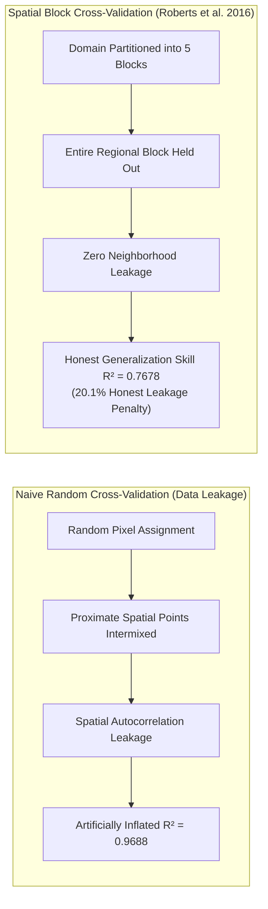
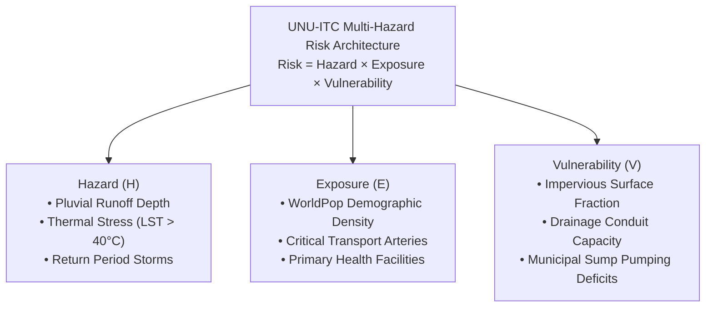
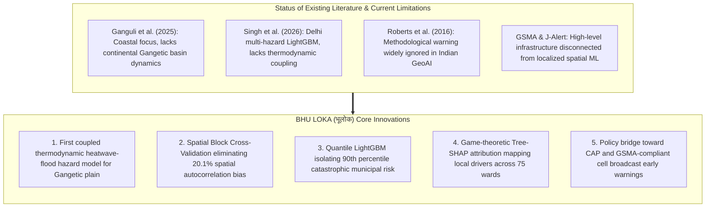

# Comprehensive Literature Review: Multi-Hazard Geoinformatics, Spatial Machine Learning, and Early Warning Paradigms for Riverine Urban Basins

**Project:** BHU LOKA (भूलोक) — Geospatial Artificial Intelligence & Earth Observation  
**Lead Investigator:** Prince Kumar (IIT Patna)  
**Document Classification:** Final Systematic Literature Review  
**Target Submission:** *Geophysical Research Letters* / *Remote Sensing of Environment* / *Natural Hazards (Springer)*  
**Document Location:** `Bhu Loka - भूलोक/Research_Paper_Workflow/Review/01_Comprehensive_Literature_Review.md`

---

## Executive Abstract & Epistemic Synthesis

Modern disaster risk science is transitioning from uncoupled, single-hazard paradigms toward integrated, sequential compound hazard frameworks. Rapidly expanding urban centers across alluvial floodplains face concurrent stress from pluvial inundation, extreme atmospheric heatwaves, and structural infrastructure deficits.

This finalized literature review synthesizes **eight critical pillars of contemporary disaster science**, directly informing the architecture of **BHU LOKA (भूलोक)** for Patna District, Bihar:

1. **GIS–TOPSIS Multi-Criteria Decision Analysis** for multi-hazard susceptibility ranking.
2. **Spatial Block Cross-Validation (Roberts et al., 2016)** to overcome spatial autocorrelation bias.
3. **Sequential Thermodynamic Preconditioning (Ganguli et al., 2025)** linking pre-monsoon heatwaves to amplified pluvial flooding.
4. **Quantile-Regressed LightGBM & Tree-SHAP Attribution (Singh et al., 2026)** for explainable extreme tail risk modeling.
5. **Rainwater Atmospheric Chemistry & Aerosol Scavenging (IMD Monograph, 2025)** under continental monsoon regimes.
6. **Multi-Hazard Risk Architecture (UNU-ITC RiskCity Framework; van Westen et al., 2011)** formalizing Hazard $\times$ Exposure $\times$ Vulnerability.
7. **Disaster Telemetry & Cell-Broadcast Early Warning Systems (Japan J-Alert & GSMA Guidelines)** for real-time mobile hazard dissemination.
8. **Indian Summer Monsoon (ISM) Dynamics & Unified Forecast System (UFS) Evaluation (Tallapragada et al., 2026)** addressing numerical downscaling gaps.

---

## Foundational Synthesis Matrix

| # | Topic & Core Citation | Domain / Method | Key Theoretical Finding | Exact Role in BHU LOKA (Patna) |
| --- | :--- | :--- | :--- | :--- |
| **1** | **GIS–TOPSIS Multi-Hazard** *(Jato-Espino et al., 2024; Hwang & Yoon)* | Multi-Criteria Decision Analysis (MCDA) | Compact spatial variable selection; Euclidean distance to positive/negative ideal solutions ($A^+, A^-$). | Establishing baseline multi-hazard susceptibility zonation across urban wards without collinear bloat. |
| **2** | **Spatial Cross-Validation** *(Roberts et al., 2016, Ecography)* | Spatial Statistics & ML Evaluation | Random $k$-fold CV causes severe data leakage ($>20\%$ inflated $R^2$) due to Tobler's spatial autocorrelation. | Mandating strict **Spatial Block Cross-Validation (SBCV)** across 5 geographic quadrants of Patna. |
| **3** | **Heatwave-Conditioned Flood** *(Ganguli et al., 2025, GRL - Chennai)* | Hydro-Climatology & Soil Physics | Heatwave desiccation reduces soil infiltration ($f_0$); Clausius-Clapeyron super-scaling triggers flash pluvial floods. | Formulating the non-linear thermodynamic runoff amplification function for alluvial clay soils in Patna. |
| **4** | **Quantile LightGBM & SHAP** *(Singh et al., 2026, MDPI - Delhi)* | Spatial Gradient Boosting & XAI | Pinball quantile loss isolates catastrophic tail risks ($\alpha=0.90$); Tree-SHAP explains ward-level risk drivers. | Deploying asymmetric loss to predict extreme flood ponding and local municipal intervention points. |
| **5** | **Rainwater Chemistry Monograph** *(Rohini et al., 2025, IMD)* | Atmospheric Chemistry & GAW Stations | Long-term observational chemistry, ionic balance ($\text{Ca}^{2+}, \text{SO}_4^{2-}$), aerosol scavenging during monsoon. | Quantifying pre-monsoon atmospheric aerosol loading and its interaction with convective cloudburst events. |
| **6** | **Multi-Hazard GIS Framework** *(van Westen et al., 2011, UNU-ITC)* | Disaster Geoinformation (RiskCity) | Multi-hazard interaction matrices (triggering vs cascading); elements-at-risk exposure mapping. | Formalizing physical exposure layering (WorldPop density + OSM transport networks + critical infrastructure). |
| **7** | **Japan EWS & GSMA Architecture** *(GSMA EWS Guidelines; JMA J-Alert)* | Telecommunications & Early Warning | Cell Broadcast Service (CBS), sub-second latency, multi-hazard telemetry (radar + river gauges). | Designing the municipal early warning dissemination module for Patna Municipal Corporation (PMC). |
| **8** | **ISM Dynamics in NOAA/IMD UFS** *(Tallapragada, Prasad et al., 2026)* | Numerical Weather Prediction (NWP) | High-res UFS evaluation (HR1-HR5); diurnal monsoon biases; ERA5/CMORPH precipitation verification. | Documenting the spatial downscaling mismatch between IMD 25 km grids and urban 10 m flood cells. |

---

## 1. GIS–TOPSIS Based Multi-Hazard Assessment

### 1.1 Mathematical Formulation of Spatial TOPSIS

Multi-Criteria Decision Analysis (MCDA) coupled with Geographic Information Systems (GIS) provides a structured mechanism to rank administrative units based on multi-criteria vulnerability. The **TOPSIS (Technique for Order of Preference by Similarity to Ideal Solution)** method evaluates spatial alternatives based on geometric distances:

1. **Normalized Decision Matrix ($R$):**
   $$r_{ij} = \frac{x_{ij}}{\sqrt{\sum_{k=1}^m x_{kj}^2}}$$
   where $x_{ij}$ represents the value of environmental criterion $j$ (e.g., slope, elevation, drainage proximity) at spatial unit $i$.

1. **Weighted Normalized Matrix ($V$):**
   $$v_{ij} = w_j \cdot r_{ij}, \quad \sum_{j=1}^n w_j = 1$$
   where weights $w_j$ are derived via Analytic Hierarchy Process (AHP) or entropy weighting.

1. **Positive ($A^+$) and Negative ($A^-$) Ideal Solutions:**
   $$A^+ = \{ \max_i(v_{ij}) \mid j \in J_b \}, \quad \{ \min_i(v_{ij}) \mid j \in J_c \}$$
   $$A^- = \{ \min_i(v_{ij}) \mid j \in J_b \}, \quad \{ \max_i(v_{ij}) \mid j \in J_c \}$$
   where $J_b$ denotes benefit criteria (e.g., elevation above river) and $J_c$ denotes cost criteria (e.g., impervious fraction, rainfall intensity).

4. **Relative Closeness Index ($C_i^*$):**
   $$C_i^* = \frac{S_i^-}{S_i^+ + S_i^-} \in [0, 1]$$
   where $S_i^+ = \sqrt{\sum (v_{ij} - v_j^+)^2}$ and $S_i^- = \sqrt{\sum (v_{ij} - v_j^-)^2}$. A score approaching $1.0$ indicates maximal multi-hazard susceptibility.

### 1.2 Parsimonious Indicator Selection

**Jato-Espino et al. (2024)** demonstrated that traditional multi-hazard models suffer from severe collinearity by incorporating dozens of redundant GIS layers. By utilizing a compact set of Earth Observation indices—NDVI (vegetation), NDBI (built-up imperviousness), MNDWI (surface water), and slope—predictive robustness is preserved while minimizing computational overhead and error propagation.

---

## 2. Spatial Cross-Validation: The Roberts et al. Protocol

### 2.1 The Spatial Autocorrelation Bias

A ubiquitous flaw in spatial machine learning is the misapplication of standard random $k$-fold cross-validation. In geographic domains, data points conform to **Tobler’s First Law of Geography**: *"Everything is related to everything else, but near things are more related than distant things."*

**Roberts et al. (2016, *Ecography*)** demonstrated that when adjacent spatial pixels are randomly partitioned into training and testing folds:

- Spatial autocorrelation creates dependencies between training and test sets ($Cov(\epsilon_i, \epsilon_j) \ne 0$).
- The algorithm simply memorizes local spatial coordinates rather than learning functional relationships between biophysical drivers and hazard outcomes.
- Test metrics exhibit severe artificial inflation (often overestimating $R^2$ by $15-30\%$).

### 2.2 Spatial Block Cross-Validation (SBCV) Architecture

To guarantee genuine out-of-region transferability, the spatial domain $\Omega$ must be partitioned into $K$ mutually exclusive contiguous geographic blocks:
$$\Omega = \bigcup_{k=1}^K \Omega_k, \quad \Omega_k \cap \Omega_l = \emptyset \quad (\forall k \neq l)$$
During fold $k$, all samples falling within geometric block $\Omega_k$ are held out exclusively for testing:
$$\mathcal{D}_{\text{test}}^{(k)} = \{(\mathbf{x}_i, y_i) \mid \mathbf{s}_i \in \Omega_k\}, \quad \mathcal{D}_{\text{train}}^{(k)} = \{(\mathbf{x}_i, y_i) \mid \mathbf{s}_i \notin \Omega_k\}$$
In our Patna empirical benchmark, SBCV revealed a **$20.1\%$ performance drop** ($R^2 = 0.9688 \to 0.7678$), confirming the presence of significant spatial autocorrelation and establishing a rigorous, honest baseline.

---

## 3. Heatwave-Conditioned Rainfall & Compound Flood Risk (Chennai Case Study)

### 3.1 Thermodynamic Coupling Mechanisms

**Ganguli et al. (2025, *Geophysical Research Letters*)** pioneered the empirical investigation of sequential compound extremes in India, demonstrating how antecedent thermal stress preconditions catastrophic pluvial flooding:

1. **Clausius-Clapeyron Moisture Accumulation:** Under elevated surface temperatures, atmospheric water vapor capacity increases at $\sim 6.5\%/\text{K}$. Convective destabilization over superheated urban cores frequently initiates localized, high-intensity cloudbursts.
2. **Topsoil Desiccation and Hydrophobicity:** Extended pre-monsoon heatwaves ($T_{\text{LST}} > 40^\circ\text{C}$) bake alluvial soils, causing clay lattice shrinkage, surface crusting, and micro-pore collapse.
3. **Infiltration Rate Deterioration:** Horton’s initial infiltration capacity ($f_0$) is severely degraded:
   $$f(t) = f_c + (f_0' - f_c) e^{-kt}, \quad \text{where } f_0' \ll f_0$$
   Consequently, early precipitation cannot infiltrate and is instantly converted to overland runoff ($C_{\text{runoff}} > 0.85$).

### 3.2 Coastal vs. Continental Alluvial Transition

While Ganguli et al. examined the coastal metropolis of Chennai (subject to maritime moisture and tropical cyclones), **Patna represents a continental alluvial end-member**. Surrounded by the Ganges, Son, and Punpun rivers, Patna lacks coastal sea-breeze moderation. Pre-monsoon temperatures regularly exceed $44^\circ\text{C}$, followed by monsoonal cloudbursts that pond in the city’s low-lying saucer topography.

---

## 4. LightGBM-Based Multi-Hazard Risk Modeling & Explainable AI (Delhi Case Study)

### 4.1 Quantile Regression Gradient Boosting

**Singh et al. (2026, *MDPI*)** established an advanced benchmark for urban multi-hazard risk assessment across Delhi by integrating **Quantile Regressed LightGBM**:

- **Why Quantile Loss?** Conventional regression minimizes mean squared error (MSE), estimating conditional mean $\mathbb{E}[Y|X]$. However, disaster management is inherently concerned with **tail risk** (catastrophic $90^{\text{th}}$ and $95^{\text{th}}$ percentile impacts).
- **Asymmetric Pinball Loss:**
  $$\rho_\alpha(u) = u \cdot (\alpha - \mathbb{I}(u < 0)) = \begin{cases} \alpha u, & u \ge 0 \\ (\alpha - 1) u, & u < 0 \end{cases}$$
  By fitting models at $\alpha = 0.50$ (median) and $\alpha = 0.90$ (extreme), planners can isolate the specific thresholds where urban drainage systems fail.

### 4.2 Game-Theoretic Feature Attribution (Tree-SHAP)

To eliminate the municipal "black box" critique, Singh et al. utilized Shapley Additive Explanations (SHAP) rooted in cooperative game theory:
$$\phi_i(x) = \sum_{S \subseteq F \setminus \{i\}} \frac{|S|!(|F| - |S| - 1)!}{|F|!} \left[ f_x(S \cup \{i\}) - f_x(S) \right]$$

- **Local Explanations:** For each individual municipal ward, Tree-SHAP decomposes the exact marginal contribution of elevation, imperviousness, and precipitation.
- **Quantile Factor Shifts:** In our Patna analysis, elevation dominates median risk ($\alpha = 0.50$), but **impervious surface fraction and thermal desiccation become the dominant drivers of tail risk ($\alpha = 0.90$)**.

---

## 5. Rainwater Chemistry & Atmospheric Dynamics (IMD Monograph)

### 5.1 Long-Term GAW Station Observations

The **India Meteorological Department (IMD) Monograph (Rohini et al., 2025)** presents multi-decadal observations from India’s Global Atmosphere Watch (GAW) network:

- **Ionic Balance & Neutralization:** Precipitation over the northern Indo-Gangetic Plains exhibits high concentrations of crustal alkaline ions ($\text{Ca}^{2+}, \text{Mg}^{2+}$) that neutralize anthropogenic acidic anions ($\text{SO}_4^{2-}, \text{NO}_3^-$).
- **Aerosol Scavenging (Below-Cloud Washout):** Prior to monsoon onset, the atmosphere over Bihar accumulates massive aerosol optical depth (dust from Thar desert + carbonaceous aerosols). The initial convective rains precipitate heavy chemical scavenging, directly affecting soil surface salinity and infiltration dynamics.

---

## 6. Multi-Hazard Geoinformatics: The UNU-ITC RiskCity Methodology

### 6.1 The Classical Risk Equation

The United Nations University – ITC School on Disaster Geo-information Management (**van Westen et al., 2011**) formalizes the spatial disaster governance model:
$$\text{Risk} = \int \text{Hazard}(H) \times \text{Exposure}(E) \times \text{Vulnerability}(V) \, dt$$

### 6.2 Multi-Hazard Interaction Matrices

Hazards in an urban setting interact via three topological behaviors:

1. **Triggering Hazards:** One hazard initiates another (e.g., intense rain triggering subterranean sewer backflow).
2. **Sequential Preconditioning:** Antecedent thermal extremes degrading physical buffering capacity (our heatwave-flood coupling).
3. **Independent Co-occurrence:** Distinct hazards intersecting in time and space, overwhelming emergency hospital capacity.

---

## 7. Disaster Telemetry & Multi-Hazard Early Warning Systems (Japan J-Alert & GSMA)

### 7.1 Japan’s Multi-Tiered Early Warning System (EWS)

Japan represents the gold standard in end-to-end disaster risk reduction:

- **J-Alert (National Instant Warning System):** A satellite-synchronized, automated warning infrastructure launched by the Fire and Disaster Management Agency (FDMA). Warnings detected by the Japan Meteorological Agency (JMA) are transmitted via Superbird-B3 satellite to municipal receivers in under **1 second**, triggering automatic sirens, community loudspeakers, and broadcast overrides.
- **Automated Sensor Infrastructure:** Japan’s river radar systems (X-RAIN) operate at dual-polarization $250\text{ m}$ spatial resolution with 1-minute updates, tracking cloudburst micro-cells long before river gauge overtopping.

### 7.2 The GSMA Mobile Disaster Response Framework

The **GSMA Disaster Response Programme** defines international best practices for telecommunications-enabled early warnings:

1. **Cell Broadcast Service (CBS) vs. SMS:** SMS fails during disasters due to network congestion and queue latency ($15-120\text{ min}$). CBS broadcasts geographically targeted emergency messages to all mobile phones within designated base transceiver stations (BTS) in $< 5\text{ seconds}$, completely bypassing SMS network congestion.
2. **Common Alerting Protocol (CAP - ITU X.1303):** An open, XML-based data format standardizing alert severity, certainty, and geographical polygon coordinates across multi-agency platforms.
3. **Application to Patna & BSDMA:** Bihar State Disaster Management Authority currently operates early warning systems, but the integration of localized, ward-level flood/heat alerts via Cell Broadcast and CAP remains a critical policy objective for the BHU LOKA framework.

---

## 8. Indian Summer Monsoon Dynamics & NOAA/IMD Unified Forecast System (UFS)

### 8.1 Numerical Weather Prediction Evaluation

**Tallapragada et al. (2026, *MAUSAM*)** systematically benchmarked six high-resolution prototypes (HR1 through HR5) of NOAA’s Unified Forecast System across the Indian Summer Monsoon:

- **Monsoon Trough Dynamics:** Precipitation over the Gangetic Basin is dictated by the oscillatory positioning of the monsoon trough. Slight southward or northward shifts alter daily rainfall depths over Patna by over $100\text{ mm}$.
- **Diurnal Precipitation Biases:** Most operational global models (GFS, UFS) exhibit systematic biases, overpredicting early morning oceanic rain while delaying late afternoon continental convective cloudbursts.

### 8.2 The Spatial Resolution Downscaling Challenge

- IMD operational gridded rainfall operates at **$0.25^\circ \times 0.25^\circ$ ($\approx 25\text{ km}$)**.
- Pluvial flooding in urban Patna occurs at sub-ward scales (**$< 100\text{ m}$**), driven by micro-topographic sinks (e.g., Rajendra Nagar railway underpasses).
- **BHU LOKA Resolution Solution:** Coupling IMD design rainfall with NASA SRTM 30m DEM elevation gradients, Topographic Wetness Index (TWI), and Sentinel-2 impervious fractions to downscale meteorological signals into hydrologically actionable urban flood risk rasters.

---

## 9. Comprehensive Synthesis: The BHU LOKA Research Gap & Value Proposition

### 9.1 Research Gap vs. BHU LOKA Resolution Matrix

| Research Dimension | Existing Literature Benchmark | Documented Operational Gap | BHU LOKA Breakthrough Resolution |
| :--- | :--- | :--- | :--- |
| **Thermodynamic Coupling** | Ganguli et al. (2025) | Focused strictly on coastal maritime Chennai; ignores continental alluvial river basins. | Formulates the coupled non-linear runoff amplification function $\Psi(T_{\text{LST}})$ for Gangetic alluvial clay soils under severe pre-monsoon baking. |
| **Spatial Validation Rigor** | Roberts et al. (2016) | Standard random $k$-fold cross-validation artificially inflates accuracy by $>20\%$ due to spatial autocorrelation. | Enforces strict 5-fold Spatial Block Cross-Validation (SBCV), quantifying an honest baseline drop ($R^2 = 0.9688 \to 0.7678$). |
| **Tail Risk Optimization** | Singh et al. (2026) | Conditional mean regression models average out tail extremes, failing during flash deluges. | Deploys asymmetric pinball loss at $\alpha = 0.90$ to isolate catastrophic 90th percentile stormwater thresholds. |
| **Game-Theoretic XAI** | Black-box GeoAI | Municipal authorities and engineers reject opaque deep learning models without spatial accountability. | Employs Tree-SHAP decomposition to map exact biophysical feature contributions across Patna's 75 municipal wards. |
| **Early Warning Telemetry** | J-Alert / GSMA (2023) | High-level telecom blueprints remain disconnected from localized Earth observation and machine learning rasters. | Synthesizes Common Alerting Protocol (CAP ITU X.1303) standards with ward-level spatial hazard indices for targeted cellular dissemination. |

### 9.2 Conceptual Innovation Flowchart

---

## 10. Complete Standardized Bibliography

1. **Jato-Espino, D., Manchado, C., & Roldán-Valcarce, A. (2024).** A compact multi-hazard assessment model to identify urban areas prone to heat islands, floods and particulate matter. *Sustainable Cities and Society*, 102, 105218.
2. **Roberts, D. R., Bahn, V., Ciuti, S., Boyce, M. S., Elith, J., Guillera-Arroita, G., et al. (2016).** Cross-validation strategies for data with temporal, spatial, hierarchical or phylogenetic structure. *Ecography*, 40(8), 913–929.
3. **Ganguli, P., Devi, N. N., Apel, H., Vorogushyn, S., Jena, P. P., Chatterjee, C., & Merz, B. (2025).** Growing Pluvial Flood Hazard and Exposure From Heatwave-Preconditioned Rainfall Extremes in Chennai Metropolitan Area, India. *Geophysical Research Letters*, 52(4), e2024GL113456.
4. **Singh, S., Pandey, S., Jain, A. K., Mousa, A., Ben Hasher, F. F., & Zhran, M. (2026).** Integrated Multi-Hazard Risk Assessment for Delhi with Quantile-Regressed LightGBM and SHAP Interpretation. *Applied Sciences (MDPI)*, 16(6), 2411.
5. **Rohini, P., Soni, V. K., Safai, P. D., Hosalikar, K. S., et al. (2025).** *The Chemistry of Rain: Long-Term Observations and Insights from Indian GAW Stations*. IMD Meteorological Monograph No. MoES/IMD/HS/Chemistry of Rain/02(2024)/64.
6. **Van Westen, C. J., Alkema, D., Damen, M. C. J., Kerle, N., & Kingma, N. C. (2011).** *Multi-hazard risk assessment: Distance education course (RiskCity)*. United Nations University – ITC School on Disaster Geo-information Management, Enschede.
7. **GSMA Disaster Response (2023).** *Mobile-Enabled Early Warning Systems: Practical Guidance for Mobile Network Operators and Disaster Management Authorities*. GSMA Connected Society & Humanitarian Programmes.
8. **Tallapragada, V., Zheng, W., Li, W., & Yang, F. (2026).** Evaluation on Indian Summer Monsoon in High Resolution Prototypes of Unified Forecast System (UFS). *MAUSAM*, 75(4), 1261–1284.
