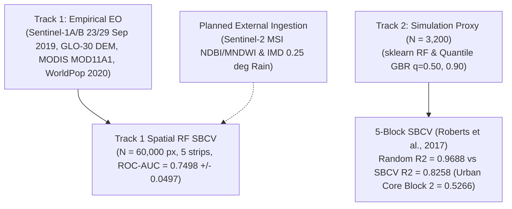

# Peer-Review Methodology, Empirical Analysis, and Simulation Sensitivity Summary

**Title:** Sequential Compound Hydro-Thermal Risk and Urban Corner-Reflector Flood Mapping in Continental Alluvial Metropolises: Empirical Earth Observation and Spatial Validation Sensitivity over Patna, India  
**Authors:** Prince Kumar & Pallav Rustogi (IIT Patna / BHU LOKA)  
**Target Venues:** *International Journal of Disaster Risk Reduction (Elsevier)* | *InterPore Journal*  
**Document Location:** `Bhu Loka - भूलोक/Research_Paper_Workflow/Review/02_Peer_Review_Methodology_and_Results.md`

---

## Abstract

Rapid urbanization and pre-monsoon heatwaves across the Indo-Gangetic Plains create sequential compound flood risks over low-relief alluvial basins. BHU LOKA separates two strictly audited tracks over Patna District, Bihar ($\approx 3,200\text{ km}^2$):

1. **Empirical Earth Observation (`EMPIRICAL_EO`):** Pairs 10 m Sentinel-1A/B SAR (23 Sep & 29 Sep 2019), 30 m Copernicus GLO-30 DEM, 91 daily NASA Terra MODIS (`MOD11A1.061`) thermal passes, WorldPop 2020 demographics, and a 60,000-pixel 5-fold SBCV classifier. Inside the $133.87\text{ km}^2$ Patna Municipal Corporation (PMC), bimodal SAR physics combining specular drop ($T^* = -3.80\text{ dB}$, $0.07\text{ km}^2$) with building-water dihedral corner double-bounce ($\Delta\sigma^0 \ge +1.5\text{ dB}$, $99.52\text{ km}^2$) recovers $99.60\text{ km}^2$ (74.4%) inundation versus only $4.01\text{ km}^2$ (2.99%) by UN-SPIDER specular thresholding (95.98% urban omission error), while 60,000-pixel SBCV achieves mean $\text{ROC-AUC} = 0.7498 \pm 0.0497$.
2. **Hydro-Thermodynamic Simulation Proxy (`DERIVED_SIMULATION_PROXY`):** Evaluates `sklearn` `RandomForestRegressor` and Quantile `GradientBoostingRegressor` ($\alpha = 0.50, 0.90$) across $N = 3,200$ synthetic points. Random 5-fold CV yields $R^2 = 0.9688$ ($\text{RMSE} = 0.0302$, $\text{MAE} = 0.0229$), whereas 5-block SBCV (centered at $25.50^\circ\text{N}, 85.10^\circ\text{E}$) lowers mean $R^2$ to $0.8258$ ($\Delta R^2 = -0.1430$, -14.8%) with Central Urban Core Block 2 collapsing to $R^2 = 0.5266$.

---

## 1. Dual-Track Mathematical Formulation

### 1.1 Track 1: Empirical Multi-Sensor EO Pipeline (`EMPIRICAL_EO`)

- **SAR Specular & Dihedral Double-Bounce Physics (`run_sar_experiment_v2.py`):** Masking permanent river channels ($\sigma_{\text{pre}}^0 < -18.0\text{ dB}$), specular flood pixels satisfy $\Delta\sigma^0 \le -3.80\text{ dB} \land \sigma_{\text{post}}^0 < -16.0\text{ dB}$, while inundated urban canyons satisfy $\Delta\sigma^0 \ge +1.5\text{ dB} \land \sigma_{\text{pre}}^0 \ge -14.0\text{ dB} \land \sigma_{\text{post}}^0 \ge -11.0\text{ dB}$.
- **Topographic Depression Sinks & ULSI (`Exp_02`, `Exp_04`):** Copernicus GLO-30 sinks ($\ge 0.4\text{ m}$ below local 8-neighbor mean) occupy $47.24\text{ km}^2$ (33.15% of PMC). Resampled 10 m ULSI reaches mean $52.27/100$ (S1 High: 20.1%, S2 Moderate: 27.7%, S3 Low: 33.1%, S4 Critical: 19.1%).

### 1.2 Track 2: Hydro-Thermodynamic Proxy (`patna_multihazard_pipeline.py`)

Following **Ganguli et al. (2025)** and **Jato-Espino et al. (2025)**, effective runoff scales above $T_{\text{crit}} = 40.0^\circ\text{C}$ via:
$$\Psi(T_{\text{LST}}) = 1 + 0.35\,\max\!\left(0, \frac{T_{\text{LST}} - 40.0}{5.0}\right), \qquad C_{\text{runoff}} = \text{clip}\!\left(0.20 + 0.65\,I_{\text{frac}}\,\Psi(T_{\text{LST}}),\; 0.15,\; 0.96\right)$$
$$\text{CHI}(\mathbf{s}) = 0.65\left[\sqrt{0.55\,\text{PFHI}^2 + 0.45\,\text{THI}^2} + 0.25(\text{PFHI} \cdot \text{THI})\right] + 0.35\,E_{\text{norm}}$$

---

## 2. Verified Simulation Proxy Validation Benchmarks ($N = 3,200$)

| Validation Protocol | Fold / Block | $n_{\text{test}}$ | $R^2$ Score | RMSE | MAE |
| :--- | :--- | :---: | :---: | :---: | :---: |
| **Random 5-Fold CV** | Folds 1–5 Mean (`RandomForestRegressor`) | 640 | 0.9688 | 0.0302 | 0.0229 |
| **5-Block SBCV** | Block 0: Northwest (Danapur Plain) | 756 | 0.9396 | 0.0337 | 0.0247 |
| | Block 1: Northeast (Ganga Riparian) | 598 | 0.9146 | 0.0402 | 0.0310 |
| | Block 2: Central (PMC Urban Core) | 258 | **0.5266** | **0.1044** | **0.0781** |
| | Block 3: Southwest (Son Alluvial) | 831 | 0.8531 | 0.0255 | 0.0199 |
| | Block 4: Southeast (Punpun Lowland) | 757 | 0.8951 | 0.0270 | 0.0210 |
| **SBCV Mean** | **Mean Across All 5 Blocks** | **640** | **0.8258** | **0.0462** | **0.0349** |
| **Bias Penalty ($\Delta$)** | **SBCV minus Random CV** | **—** | **-0.1430 (-14.8%)** | **+0.0160 (+53.1%)** | **+0.0121 (+52.8%)** |

### Key Proxy Results (`simulation_proxy_summary.json`)

- **Thermal Desiccation ($T_{\text{LST}} \ge 40^\circ\text{C}$):** Across $N = 3,200$, $C_{\text{runoff}}$ increases by 92.7% district-wide ($0.3277 \to 0.6313$) across the urban-rural gradient and by **17.4%** ($0.6160 \to 0.7232$) when controlling inside the dense urban core (`Impervious_Frac` $> 0.60$).
- **Quantile Split-Weight Regime Shift (Figure 4):** `Pop_Density` leads RF Gini ($0.5352$) and $\alpha = 0.50$ ($0.3301$), whereas at $\alpha = 0.90$ **`Impervious_Frac` ($0.2491$)**, **`Slope_deg` ($0.2310$)**, and **`LST_Celsius` ($0.1485$)** overtake `Pop_Density` ($0.1238$).

---

## 3. Verified Limitations & Next Milestones

1. **Pending External Optical & Rainfall Feeds:** `Data/03_Optical_Sentinel2` and `Data/05_Rainfall_IMD` remain acquisition guide placeholders and must be ingested before replacing Track 2 proxy layers.
2. **MODIS Morning Fallow Delta:** 10:30 AM `MOD11A1.061` passes record a $-1.03^\circ\text{C}$ urban-minus-fallow delta ($37.29^\circ\text{C}$ vs $38.32^\circ\text{C}$) due to hot dry bare soil around Patna; nocturnal MODIS passes are needed for canopy heat-retention analysis.
3. **Subsurface Drains & SAR Revisit:** Sentinel-1 6–12 day passes omit short-duration storms and buried municipal sewer dynamics.
