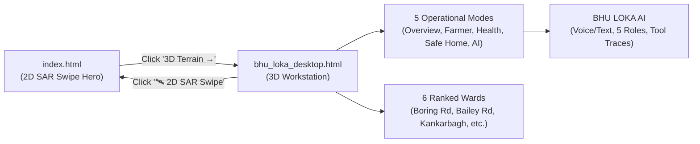

# BHU LOKA (भूलोक) — User Flow & Platform Guide (यूज़र गाइड)
### NASA Space Apps Challenge 2026 (Bhopal) · Challenge: "Dancing with the SARs"
**Author:** Prince Kumar (`PA2511CDH37`, IIT Patna M.S. CSDA) &middot; **Supervisor:** Dr. Pallav Rustogi  
**Study Area:** Patna & Ganga Floodplain, Bihar (25.594°N, 85.137°E)

---

## 1. Quick Overview (संक्षिप्त परिचय)

**BHU LOKA** is a sovereign Earth intelligence platform designed to demonstrate the unique superpower of Synthetic Aperture Radar (SAR): **active microwaves penetrate thick monsoon clouds and darkness when optical satellites (MODIS, Landsat) are 100% blind.**

The platform connects two primary interactive workstations:
1. **[index.html](file:///c:/Users/ljpri/OneDrive/Desktop/Learning%20Pathways/LearningPathways/Bhu%20Loka%20-%20भूलोक/index.html)** — **2D SAR Swipe Hero:** Compare pre-flood dry baseline (23 Sep 2019) vs peak deluge (29 Sep 2019) across the Ganga basin and inspect 26.54 km² of "Naya Paani" (flood gain).
2. **[bhu_loka_desktop.html](file:///c:/Users/ljpri/OneDrive/Desktop/Learning%20Pathways/LearningPathways/Bhu%20Loka%20-%20भूलोक/bhu_loka_desktop.html)** — **3D Desktop Workstation:** Explore Patna's 3D topography (Copernicus DEM), inspect 6 ranked wards, switch between 4 citizen personas (Farmer, Health, Safe Home, AI), and talk to **BHU LOKA AI**.

---

## 2. Step-by-Step User Journey (चरणबद्ध यूज़र सफ़र)

### चरण 1 (Step 1): 2D SAR स्वाइप तुलना (`index.html`)
- **क्या करें (What to do):** `index.html` खोलें। बीच में स्थित वर्टिकल स्लाइडर कर्टेन (`◄||►`) को बाएं और दाएं ड्रैग करें।
- **क्या दिखेगा (What you see):**
  - **बाईं ओर (Left):** 23 Sep 2019 का प्री-फ्लड सूखा बेसलाइन (Dry Baseline)।
  - **दाईं ओर (Right):** 29 Sep 2019 का पीक मानसून जलभराव (Peak Deluge)।
  - **"Naya Paani" (सियान रंग का ओवरले):** 26.54 km² नया जलभराव क्षेत्र, जो रडार बैकस्कैटर में ओत्सु थ्रेसहोल्ड (-16.42 dB) द्वारा निकाला गया है।
- **रडार पिक्सेल इंस्पेक्टर (Pixel Inspector):** नक्शे पर कहीं भी माउस घुमाएं। ऊपर-दाएं HUD में वास्तविक बैकस्कैटर $\sigma^0$ मान (dB) और भौतिक प्रकीर्णन (Specular Water, Double-Bounce, Rough Alluvium) तुरंत दिखाई देगा।
- **अतिरिक्त टूल्स:** हेडर में `NISAR Guide`, `Transect Profile`, `Wards Exposure`, और `User Guide` पर क्लिक करके वैज्ञानिक रिपोर्ट देखें।

---

### चरण 2 (Step 2): 3D टेरेन और वॉर्ड विश्लेषण (`bhu_loka_desktop.html`)
- **क्या करें (What to do):** हेडर में `3D Terrain →` लिंक पर क्लिक करें या सीधे `bhu_loka_desktop.html` खोलें।
- **3D कैमरा नेविगेशन:**
  - **Rotate:** Left-Click + Drag
  - **Zoom:** Mouse Scroll Wheel
  - **Pan:** Right-Click + Drag
- **वॉर्ड्स पर क्लिक करें (Click Ranked Wards):**
  - **Boring Road:** कैमरा 53.2m की ऊंची सुरक्षित कछार पर जाएगा। फ़्लड रिस्क 0.4% (सुरक्षित)।
  - **Kankarbagh Core:** कैमरा 44.5m के प्राकृतिक बेसिन (Sink) पर जाएगा। फ़्लड रिस्क 98.8% (2019 में 6 से 8 फ़ीट पानी भरा था)।
  - **Danapur Cantt:** 54.1m levee terrace, शून्य जलभराव।
- **टेरेन लेयर्स:** नीचे लेयर चेकबॉक्स (Sentinel-1 Flood Mask, Ganga/Son Rivers, 3D Wards) ऑन/ऑफ़ करके 3D विज़ुअलाइज़ेशन देखें।

---

### चरण 3 (Step 3): 4 नागरिक वर्ग (4 Citizen Personas)
बाएं पैनल में ऊपर दिए गए 5 टैब पर क्लिक करके अलग-अलग समाधान देखें:

| मोड (Mode) | किसके लिए (Target) | मुख्य जानकारी (Key Verdict & Recommendations) |
|---|---|---|
| **Overview** | सामान्य नागरिक / अधिकारी | वॉर्ड की ऊंचाई, 2019 बाढ़ जोखिम, गंगा से दूरी, और कुल जनसंख्या। |
| **Farmer (किसान)** | किसान / कृषि विशेषज्ञ | मिट्टी की किस्म (Sandy Loam vs Heavy Clay), अनुशंसित फसलें (गेहूं HD-2967, जलमग्न धान), और सिंचाई चक्र। |
| **Health** | आम जनता / बुजुर्ग / बच्चे | सुरक्षित आउटडोर व्यायाम समय (06:00 - 08:30 AM), Open-Meteo PM2.5 AQI, और हीटवेव अलर्ट। |
| **Safe Home** | घर खरीदार / कारोबारी | 2019 वाटरमार्क (47.0m) से ऊंचाई का अंतर, रियल एस्टेट सुरक्षा स्कोर, और ड्रेनेज प्लिंथ सलाह। |
| **BHU LOKA AI** | इंटरैक्टिव शोधकर्ता | बहु-खतरा संश्लेषण और वैज्ञानिक AI टर्मिनल। |

---

### चरण 4 (Step 4): BHU LOKA AI (भूलोक AI) से बातचीत
- **कहाँ मिलेगा:** `bhu_loka_desktop.html` के दाएं पैनल में।
- **वॉयस इनपुट (Voice Input):** माइक बटन (`🎙️`) पर क्लिक करें। `Listening...` इंडिकेटर दिखने पर हिन्दी या अंग्रेज़ी में सवाल बोलें।
- **वॉयस आउटपुट (Voice Output):** स्पीकर बटन से बोलकर उत्तर सुनने की सुविधा ऑन/ऑफ़ करें।
- **5 रोल प्रीसेट्स (5 Role Presets):**
  - `🌾 Farmer (किसान)`
  - `💼 Business`
  - `🎓 Student`
  - `👷 Worker`
  - `🔬 Researcher`
- **टूल ट्रेस (Visible Tool Traces):** जब AI से कहें *"kankarbagh dikhao"* या *"rotate terrain"*, तो AI सीधे मैप को घुमाएगा या कैमरा मूव करेगा और चैट में टूल कॉल का पारदर्शी ट्रेस दिखाएगा।
- **वैज्ञानिक प्रामाणिकता:** हर उत्तर के नीचे `Why this answer?` खोलकर Copernicus DEM, Sentinel-1, और Open-Meteo का डेटा स्रोत देखा जा सकता है।

---

## 3. Data Provenance & Scientific Integrity (डेटा स्रोत)

| डेटासेट (Dataset) | एजेंसी (Agency) | प्रकार (Type) | रिज़ॉल्यूशन (Resolution) | उद्देश्य (Purpose) |
|---|---|---|---|---|
| **Sentinel-1 C-SAR** | ESA / ASF Vertex | **OBSERVED** | 10m pixel | 23 Sep 2019 vs 29 Sep 2019 जलभराव और बैकस्कैटर $\sigma^0$ |
| **Copernicus DEM** | ESA / Airbus | **MEASURED / MODELLED** | 30m GLO-30 | 3D स्थलाकृति और ऊंचाई AMSL (सटीकता ~1.8m RMSE) |
| **NASA POWER** | NASA Langley | **MODELLED** | 0.5° grid | 30-वर्षीय वर्षा climatology और सौर विकिरण |
| **Open-Meteo NWP** | European NWP | **MODELLED** | 11 km | लाइव तापमान, आर्द्रता और PM2.5 वायु गुणवत्ता |
| **SoilGrids** | ISRIC | **MODELLED** | 250m grid | जलोढ़ मिट्टी वर्गीकरण (Sandy Loam, Clay Loam) |

---

## 4. Troubleshooting & FAQ (अक्सर पूछे जाने वाले सवाल)

1. **क्या रडार ज़मीन के नीचे देख सकता है?**  
   *नहीं।* रडार सतह की नमी और खुले पानी को देखता है। मिट्टी के नीचे का डेटा मॉडल किया हुआ (SoilGrids) है।
2. **अगर इंटरनेट धीमा हो तो क्या होगा?**  
   BHU LOKA में ऑफ़लाइन सॉवरेन बेसलाइन पहले से शामिल है। API फ़ेल होने पर भी कैश्ड वैज्ञानिक डेटा स्वतः लोड होता है।
3. **क्या यह मेडिकल या कानूनी सलाह है?**  
   *नहीं।* स्वास्थ्य और रियल एस्टेट सुझाव केवल सूचनात्मक रिमोट-सेंसिंग मार्गदर्शन हैं।
