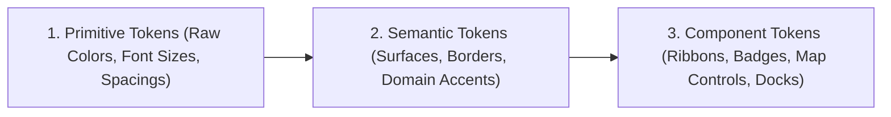

# BHU LOKA (भूलोक) — Design System & Visual Architecture (Phase 1 Audit)

---

## 1. Visual Identity & Design Principles

BHU LOKA is engineered as a high-precision Earth Observation and Planetary GIS Workstation. The design rejects decorative gimmicks (such as neon gradients, non-functional cards, or synthetic telemetry) in favor of **restrained scientific clarity, deep obsidian slate surfaces, deep forest green accents, and map-first spatial organization**.

### Core Pillars
1. **Map-First Priority**: The geospatial map/globe canvas occupies 100% of the active stage. Toolbars and inspectors dock subtly at the perimeter with translucent glassmorphic hairpins.
2. **Scientific Integrity**: Every layer, chart, and metric displays provenance, sensor type, acquisition timestamp, and accuracy grade (`OBSERVED`, `MODELLED`, `DERIVED`, `UNAVAILABLE`).
3. **Ergonomic Information Density**: 8-point spatial grid rhythm with high-contrast geometric sans (`Inter`) for text and monospace (`JetBrains Mono`) for telemetry, coordinates, and cryptographic hashes.

---

## 2. Three-Layer Token Architecture



### Layer 1: Primitive Tokens
```css
/* Primitives */
--color-slate-950: #05080f;
--color-slate-900: #0a0f18;
--color-slate-800: #121a26;
--color-slate-700: #1e293b;
--color-slate-400: #94a3b8;
--color-slate-200: #e2e8f0;
--color-slate-50:  #f8fafc;

--color-forest-950: #04140d;
--color-forest-900: #072216;
--color-forest-800: #0e3b26;
--color-emerald-500: #10b981;
--color-emerald-400: #34d399;

--color-cyan-900: #082f49;
--color-cyan-500: #06b6d4;
--color-cyan-400: #38bdf8;

--color-crimson-900: #4c0519;
--color-crimson-500: #f43f5e;
--color-crimson-400: #fb7185;

--color-teal-900: #042f2e;
--color-teal-500: #14b8a6;
--color-teal-400: #2dd4bf;
```

### Layer 2: Semantic Domain Tokens
- **Global Background Canvas**: `--bg-app: #060a0f;`
- **Surface Elevation Level 1**: `--surface-panel: rgba(10, 16, 24, 0.82);`
- **Surface Elevation Level 2**: `--surface-card: rgba(14, 22, 33, 0.90);`
- **Surface Elevation Level 3**: `--surface-modal: rgba(7, 12, 19, 0.96);`
- **Hairline Border**: `--border-hairline: rgba(255, 255, 255, 0.08);`
- **Domain Accents**:
  - `Earth & Farmer`: `--accent-forest: #10b981;` (Grounded nature & spectral agriculture)
  - `Hazard`: `--accent-hazard: #ef4444;` (Calibrated crisis & deluge alerts)
  - `AI Console`: `--accent-ai: #10a37f;` (Clean research intelligence)
  - `Land Studio`: `--accent-gis: #38bdf8;` (Precision vector drafting & CAD)
  - `Public Health`: `--accent-health: #14b8a6;` (Therapeutic bio-resilience)

### Layer 3: Component Specifications
- **Navigation Ribbon**: Top bar height `48px`, fixed at `z-index: 50`. Single-line layout with integrated place/coordinate search input, module buttons, and quick presets.
- **Docked Side Rails**: Width `320px` (desktop), collapsible to `0px` for theater mode (`isTheaterMode: true`).
- **Composer / Input Bar**: Height `44px`, `border-radius: 16px`, subtle background `#161b22`, circular emerald action button (`w-8 h-8 rounded-xl`).
- **Map Floating Overlays**: `backdrop-filter: blur(16px)`, `border: 1px solid rgba(255, 255, 255, 0.08)`, `box-shadow: 0 8px 32px rgba(0, 0, 0, 0.6)`.

---

## 3. Responsive Breakpoint & Mobile Ergonomics

| Breakpoint | Target Viewport | Map Presentation | Navigation / Rails | Touch Considerations |
| :--- | :--- | :--- | :--- | :--- |
| **Desktop (≥ 1280px)** | Workstation Displays | Full stage center | Side-by-side left explorer & right inspector | Hover tooltips, precision crosshairs |
| **Tablet (768px - 1279px)**| iPad Pro / Surface | Adaptive stage | Auto-collapsible side drawers (`w-72`) | 44px tap targets, multi-touch pinch zoom |
| **Mobile (< 768px)** | iOS / Android Viewports | 100vw x 100dvh | Bottom sheet drawer + top compact brand pill | Safe-area padding, swipe gestures |
