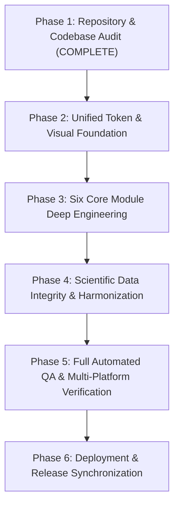

# BHU LOKA (भूलोक) — Implementation Roadmap & Execution Plan

---

## 1. Overview & Strategy
This roadmap guides the systematic re-engineering of BHU LOKA into a commercial-grade, scientifically credible Earth Intelligence Workstation. Execution follows strict verification gates: no code is pushed to production without passing tests, explicit user approval, and zero synthetic data fabrication.

---

## 2. Staged Phase Breakdown

### Phase 1: Repository Audit & Baseline Verification (COMPLETED)
- Complete directory, file, and dependency inventory.
- Classification of all 25+ features into Working, Partially Working, and Unavailable.
- Verification of test suites: 83 tests in root `tests/`, 66 tests in `Models/04_Hybrid_RAG/enterprise_rag_app/tests/`. Total: 149 tests.
- Identification of root vs. `public/` sync gaps and legacy `.bak` files.

### Phase 2: Unified Design Tokens & Visual Architecture
- **Tokens**: Deep Forest Green (`#04150e`, `#082419`, `#10b981`), Obsidian Charcoal (`#060a0f`), Warm Off-White (`#f8fafc`).
- **Typography**: Inter for interface elements; JetBrains Mono for telemetry, coordinates, and metrics.
- **Components**: Standardized modal shells, collapsible side rails, floating map controls, and high-contrast status chips.

### Phase 3: Six Module Deep Engineering & Map-First Hardening
1. **HOME**: Interactive 3D WebGL Globe with live CelesTrak orbit ephemeris, Open-Meteo weather and GloFAS river telemetry, universal location search.
2. **HAZARD**: 2D Leaflet Pan-India GIS Workstation with 14 scientific overlay layers, Copernicus Sentinel-1 dual-date backscatter (`Δσ0 ≥ +1.5 dB`), and fail-closed labels.
3. **AI**: ChatGPT-inspired distraction-free conversational interface with grounded citations of GLO-30 DEM and MODIS LST, plus speech input options.
4. **LAND STUDIO**: Desktop QGIS-inspired workspace with single-panel right dock (`Toolbox`, `Inspector`, `Symbology`, `Metrics`), real dual-map 2014-2026 comparator, and BSA 2023 §63 cryptographic report export.
5. **FARMER**: Field boundary drawing, spherical Shoelace area formulas, Sentinel-2 STAC spectral indices (NDVI, NDRE, EVI), topsoil moisture, and Mandi market linkages.
6. **HEALTH**: 3D spatial epidemiology tracking stagnant water pooling (<46m AMSL) and PM2.5 silt resuspension with geolocated hospital routing.

### Phase 4: Scientific Harmonization & Provenance
- Harmonization protocol between Landsat 8 (30m) and Sentinel-2 (10m) surface reflectance bands.
- Enforce strict telemetry labeling: zero synthetic measurements; all offline sources marked `UNAVAILABLE` or `HISTORICAL BENCHMARK`.

### Phase 5: Testing & Quality Assurance
- Automated regression test execution (`pytest tests/ -v`).
- Enterprise RAG unit test execution (`pytest Models/04_Hybrid_RAG/enterprise_rag_app/tests/ -v`).
- Browser cross-testing (Chromium, Edge, Firefox) across desktop and mobile viewports.

### Phase 6: Release & Production Synchronization
- Clean legacy `.bak` files into an `archive/` directory.
- 1:1 synchronization between root files and `public/` distribution bundle.
- User review and approval prior to git commits and remote pushes.
