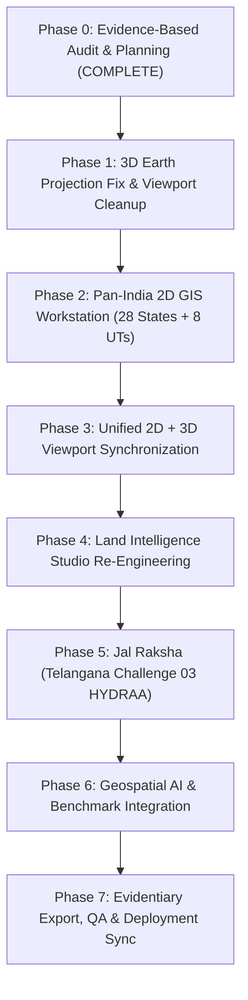

# BHU LOKA (भूलोक) — REVISED RE-ENGINEERING ROADMAP
**Sovereign Geospatial Workstation & Earth Intelligence Platform**
**Document ID:** `BL-RODM-2026-V2`  
**Date:** 20 November 2026  
**Repository Branch:** `feature/bhu-loka-india-gis-reengineering`  
**Primary Git Remote:** `competition` (`https://github.com/Amourhoffen/BhuLoka.git`)  
**Secondary Remotes:** `origin` (`https://github.com/Amourhoffen/BHU_LOKA.git`), `backup` (`https://github.com/Amourhoffen/BHU_LOKA_privite.git`)  
**Target Milestone:** Telangana Challenge 03 (HYDRAA Lake & Land Protection) & Sovereign Pan-India Workstation  
**Execution Directives:** Phase 0 Audit & Planning ONLY. No application code modifications until explicit user approval.  

---

## 1. STRATEGIC RE-ENGINEERING OBJECTIVES

The re-engineering roadmap transforms BHU LOKA into a professional, scientifically defensible, and legally compliant Earth Intelligence Workstation.

### Key Corrections Incorporated:
1. **Defensible Legal Standard**: No automated software claims of "illegal encroachment". All spatial intersections are designated `POTENTIAL SPATIAL OVERLAP — REQUIRES OFFICIAL VERIFICATION`. Dossiers are prepared as decision-support artifacts under the **Bharatiya Sakshya Adhiniyam, 2023 (BSA Section 63)** and require official field revenue survey review.
2. **Lake-Specific FTL Governance**: No universal $30\text{m}/15\text{m}/9\text{m}$ buffers. The system links specific government orders, gazetted notifications, and surveyed FTL boundaries per lake. When unavailable, it displays `LEGAL BOUNDARY UNVERIFIED`.
3. **No Arbitrary Exclusion Masks**: Arbitrary $32\text{m}$ railway and $14\text{m}$ road buffer subtractions are eliminated unless verified cadastral right-of-way (RoW) asset layers are officially present.
4. **Authentic Satellite Imagery Dates**:
   - 2014 historical baselines strictly utilize **Landsat 8 OLI** ($30\text{m}$ GSD).
   - **Sentinel-2 MSI** ($10\text{m}$ GSD) is strictly restricted to its true operational availability (**late 2015/2016 to present**).
5. **Class Harmonization**: Explicit 11-class to 7-class translation matrix between ESA WorldCover and BHU LOKA.
6. **Transparent AI Benchmarking**: Model accuracy and latency targets are classified as `PROPOSED BENCHMARK`, acknowledging that current runtime code operates on verified heuristic pipelines until model weights are trained and loaded.

---

## 2. PHASED IMPLEMENTATION TIMELINE

---

## 3. WORK BREAKDOWN STRUCTURE BY PHASE

### PHASE 1 — 3D Earth Globe Projection Fix & Viewport Cleanup
**Pre-condition**: Explicit user sign-off on Phase 0 documents.  
**Target Files**: `index.html`, `public/index.html`, `Assets/vendor/bhu_loka_theme.css`
- **Task 1.1: Fix Three.js Screen-Space Overlay Drift** [HIGH PRIORITY]
  - Refactor marker rendering in `index.html`: Continuously project each landmark's 3D geodetic position Vector3 onto the camera frustum (`vector.project(camera)`) inside `animate()`.
  - Update marker CSS `transform: translate3d(x, y, 0)` every frame.
  - Cull pins located on the far/dark side of the globe (`vector.z > 1.0` or `normal.dot(camera) < 0`).
- **Task 1.2: Remove Unwanted 3D UI Controls (Screenshot 10 Red Boxes)**
  - Remove `#vscode-activity-bar` (far-left vertical cyan/green activity rail).
  - Remove `PREDICT AREA (SBCV)` button and associated modal invocation.
  - Remove redundant `📊 PITCH DECK` button from 3D terrain sub-bar (keep single master pitch deck link in top-right utility header).
  - Remove `#bhu-time-machine` bottom timeline track and playback scrubber.
- **Task 1.3: Polish Multi-Hazard 3D Explorer (Screenshot 10 Green Boxes)**
  - Preserve center 3D terrain canvas with authentic DEM draping.
  - Maintain Horizon Year selectors (`2026`, `2027`, `2028`, `2029`, `2030`).
  - Maintain Hazard selectors (`SAT OPTICAL`, `ELEV TOPO`, `FLOOD SAR`, `THERMAL LST`, `DEPRESSION SINKS`, `SAFE LEVEES`).
  - Maintain right-hand Layer Explorer and Line Color Guide.
- **Verification Protocol**: Headless Chromium CDP testing (`docScrollH === winH`, zero console errors, zero coordinate drift during rotation).

### PHASE 2 — Pan-India 2D GIS Workstation Re-Engineering
**Target Files**: `bhu_loka_leafmap_interactive.html`, `public/bhu_loka_leafmap_interactive.html`, `Assets/vendor/bhu_loka_2d_layer_panel.js`
- **Task 2.1: Clean 2D Map Header Toolbar (Screenshot 9 Red Boxes)**
  - Remove `NASA GIBS` button (default to high-resolution Sentinel-2 / Esri satellite stream).
  - Remove `Dancing with the SARs` button and floating radar bar.
  - Remove `SAR Hero (NASA 2026)` button.
  - Remove redundant top sub-nav bar `#india-intel-main-nav` (Modules A-F + Agriculture).
- **Task 2.2: Implement Pan-India 28 States + 8 UTs Selector (Screenshot 9 Green Arrow)**
  - Replace "Bihar 38" button with a searchable Sovereign State Selector dropdown covering all **28 States and 8 Union Territories**.
  - Selecting a state flies the map to the official state bounding box and loads verified administrative district statistics.
- **Task 2.3: Layer Explorer Hardening**
  - Verify all 14 layers in the right panel (`BhuLoka2DLayerPanel`).
  - Ensure all layers expose accurate provenance (`OBSERVED`, `MODELLED`, or `UNAVAILABLE`).

### PHASE 3 — Unified 2D + 3D Viewport Synchronization
**Target Files**: `index.html`, `bhu_loka_leafmap_interactive.html`, `Assets/vendor/bhu_loka_location_engine.js`
- **Task 3.1: Bidirectional Coordinate Sync**
  - Seamlessly transfer bounding boxes between the 2D Leaflet map and 3D DEM terrain view via `Crop Bounds to 3D`.
  - Persist coordinates and zoom state via URL search parameters (`?lat=...&lon=...&zoom=...&state=...`).
- **Task 3.2: Universal India Location Search**
  - Connect top global search (`#global-location-search`) to the sovereign administrative database (`Data/01_Boundaries/bhu_loka_india_intel.sqlite`).

### PHASE 4 — Land Intelligence Studio Re-Engineering
**Target Files**: `Assets/vendor/bhu_loka_urban_studio.js`, `public/Assets/vendor/bhu_loka_urban_studio.js`
- **Task 4.1: Fix Container Unhide Lifecycle (Black Screen Bug - Screenshot 2)**
  - Inject automatic `this.leaflet.map.invalidateSize()` inside `openStudio()` and whenever switching tabs or toggling side panels.
  - Ensure center map renders satellite tiles immediately on launch without requiring manual zoom or tab toggling.
- **Task 4.2: QGIS-Inspired 3-Column Ergonomics**
  - Left Panel: Location Search, Preset Sites, AOI Shape Selection (Rectangle, Circle, Polygon), Satellite Source & Date Range.
  - Center Panel: Interactive Map Viewport with live overlay controls, bi-temporal split slider, and 3D extruded perspective.
  - Right Panel: Computed AOI Metrics (Building Footprint, Road Density, Green Canopy, Water Bodies, Mean Slope) and Composite Index.
- **Task 4.3: Manual Geometry & Layer Toggles**
  - Support user-drawn building/tree/water polygons.
  - Add layer visibility toggle switches (eye icons) for individual feature classes.

### PHASE 5 — Jal Raksha (Telangana Challenge 03 HYDRAA Lake Protection Pipeline)
**Target Files**: `Assets/vendor/bhu_loka_urban_studio.js`, `Pipelines/bhu_loka_site_analytics_api.py`
- **Task 5.1: Gazetted Lake & FTL Catalog Integration**
  - Pre-configure verified coordinates and official government notifications for key Telangana water bodies:
    - Hussain Sagar (Hyderabad) — Gazetted water spread extent $490.38\text{ acres}$
    - Osman Sagar / Gandipet (Hyderabad)
    - Durgam Cheruvu (HITEC City / Madhapur)
    - Himayat Sagar, Shamirpet Lake, Fox Sagar
- **Task 5.2: Statutory Buffer & Overlap Auditing**
  - Load lake-specific statutory buffer geometry according to applicable government orders. If absent, display `LEGAL BOUNDARY UNVERIFIED`.
  - Calculate spatial intersections against detected building footprints.
  - Flag overlaps as: `POTENTIAL SPATIAL OVERLAP — REQUIRES OFFICIAL VERIFICATION`.
  - Compute overlap area in $m^2$ and acres, and identify affected survey numbers where digitized revenue records exist.
- **Task 5.3: Bi-Temporal Decadal Change Inspection (2014 vs 2026)**
  - Multi-temporal split comparison utilizing **Landsat 8 OLI** for the 2014 baseline and **Sentinel-2 MSI** for the current 2026 surveillance pass.
  - Calculate net shoreline water contraction and structural emergence.

### PHASE 6 — Geospatial AI / ML Model Inference Engine & Benchmarking
**Target Files**: `Pipelines/bhu_loka_site_analytics_api.py`, `Assets/vendor/bhu_loka_ml_inference.js`
- **Task 6.1: SegFormer-B0 Operational Microservice**
  - Ingest windowed COGs, execute multi-spectral segmentation, and return vectorized GeoJSON polygons via FastAPI.
  - Transparently display whether the inference was generated by neural model weights or deterministic multi-spectral heuristics.
- **Task 6.2: Model Evaluation Card & Benchmarks**
  - Display proposed model benchmarks ($mIoU \ge 0.83$, $F_1 \ge 0.87$) clearly labeled as `PROPOSED BENCHMARK`.
  - Provide fallback to heuristic feature extraction when backend is offline, tagged `OFFLINE / HEURISTIC`.

### PHASE 7 — Evidentiary Reporting, Export & Production Hardening
**Target Files**: All HTML/JS files, `tests/`, `public/`
- **Task 7.1: Evidentiary Dossier Generation (BSA 2023 Section 63)**
  - PDF and Markdown export containing:
    - Satellite mission, sensor, acquisition timestamp, and cloud percentage.
    - Cryptographic SHA-256 integrity hash of raster inputs and cadastral vectors.
    - Centroid coordinates and potential spatial overlap measurements.
    - Mandatory legal disclaimer mandating field ground survey verification.
- **Task 7.2: Vector Data Export**
  - One-click RFC 7946 GeoJSON export and high-resolution PNG snapshot download.
- **Task 7.3: Quality Assurance & Deployment Synchronization**
  - Execute full test suite (`pytest tests/`) ensuring 100% pass rate.
  - Validate JavaScript syntax across all vendor files (`node -c`).
  - Synchronize all files from workspace root to `public/` for Firebase deployment.

---

## 4. IMMEDIATE NEXT STEPS

1. Present revised Phase 0 documentation and Phase 0 Evidence Report to user.
2. Await user's explicit written approval before modifying application code.
3. Upon approval, begin Phase 1: 3D Earth projection fix and legacy button cleanup.
