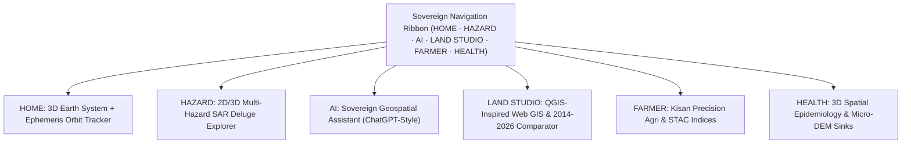

# BHU LOKA (भूलोक) — Premium Geospatial Product Design System & Architecture Specification

## 1. Executive Product Identity & Design Philosophy
BHU LOKA is a sovereign, scientific Earth Observation, Multi-Hazard Intelligence, and Planetary GIS Workstation developed at IIT Patna in collaboration with IIITDM Jabalpur.

### Core Visual Direction
- **Primary Canvas**: Dark Charcoal & Obsidian Slate (`#060a0f`, `#0a1017`, `#0e1622`).
- **Domain Identity Palette**:
  - **Earth System & Precision Agri**: Deep Forest Green (`#04150e`, `#082419`, `#0f3826`) paired with high-contrast emerald highlights (`#10b981`, `#34d399`).
  - **Hazard & Crisis Intelligence**: Deep Obsidian Charcoal (`#09090b`) paired with calibrated Crimson Alert accents (`#ef4444`, `#f87171`).
  - **Sovereign AI Console**: Charcoal Terminal Obsidian (`#0d1117`) paired with clean OpenAI Emerald (`#10a37f`).
  - **Land Studio & Cadastral GIS**: Desktop QGIS Midnight (`#040812`, `#091020`) with Electric Cyan vector accents (`#38bdf8`, `#0284c7`).
  - **Spatial Health & Epidemiology**: Therapeutic Dark Slate (`#04131a`) with Bio-Resilience Teal (`#14b8a6`).
- **Typography Floor**:
  - Primary UI & Prose: `Inter`, `-apple-system`, `BlinkMacSystemFont`, `"Segoe UI"`, `sans-serif` (letter-spacing: -0.01em).
  - Telemetry, Coordinates, Hashes & Metrics: `JetBrains Mono`, `"SF Mono"`, `Consolas`, `monospace` (letter-spacing: -0.02em).
- **Surface Elevation & Hairline Borders**:
  - Level 0 (Map / Globe Stage): Pure viewport canvas.
  - Level 1 (Docked Side Rails & Top Ribbon): `rgba(10, 16, 24, 0.82)` with `backdrop-filter: blur(16px)` and `border: 1px solid rgba(255, 255, 255, 0.08)`.
  - Level 2 (Floating Action Toolbars & Chips): `rgba(14, 22, 33, 0.90)` with `box-shadow: 0 8px 24px rgba(0, 0, 0, 0.6)`.
  - Level 3 (Modal Workspaces & Detail Inspectors): `rgba(7, 12, 19, 0.95)` with `box-shadow: 0 24px 60px rgba(0, 0, 0, 0.85)`.

---

## 2. Six Core Module Specifications (Map-First Architecture)

### Module 1: HOME (Planetary Earth System)
- **Primary Stage**: Full-screen interactive WebGL 3D Globe with NORAD CelesTrak orbital spacecraft tracking (ISRO, Starlink, Earth Observation).
- **Docked Telemetry Rails**:
  - Left Rail: Sovereign Mission Directives, Author Credentials (IIT Patna / IIITDMJ), AI Mission Console.
  - Right Rail: Live Open-Meteo & GloFAS River Flow telemetry (`min-w-0 overflow-hidden truncate`), 5-day temp & 7-day discharge sparklines, line color explainer.
- **Top Command Search**: Universal place & coordinate search bar.

### Module 2: HAZARD (SAR Flood & Multi-Hazard Intelligence)
- **Primary Stage**: 14-layer pan-India Leaflet GIS map with Copernicus Sentinel-1 dual-date backscatter (`Δσ0 >= +1.5 dB`).
- **Layers Exposed**: Heat Area (MODIS LST), Flood Zone (Modelled S1 SAR), Multi-Hazard, Elevated Safe Zones (>52m AMSL), DEM Elevation, Critical Infrastructure, Water Bodies.
- **Scientific Rigor**: Strict badges (`OBSERVED`, `MODELLED`, `DERIVED`, `UNAVAILABLE`) on every single layer without fabricated data.

### Module 3: AI (Geospatial Intelligence Console)
- **Design Inspiration**: Minimalist, distraction-free conversational console (OpenAI / Claude research workbench).
- **Composer Bar**: Rounded obsidian glass capsule (`rounded-2xl bg-[#161b22] border border-white/10 p-1.5`) with circular emerald submit action and opt-in Hindi/English voice input.
- **RAG Provenance**: Grounded citations of Copernicus GLO-30 DEM, Sentinel-1 SAR bimodal distribution, and MODIS LST thermal metrics.

### Module 4: LAND STUDIO (QGIS-Inspired Professional Web GIS)
- **Workspace Layout**:
  - Top Ribbon: Search bar (with Nominatim geocoder + Lat/Lon parsing), Quick Lake Presets (`Hussain Sagar`, `Durgam Cheruvu`, etc.), Ingest Vector, GeoJSON Export, Spatial Toolbox actions.
  - Left Rail: Area of Interest (AOI) selection (500m, 1km, 2km, 5km, Screen, Rectangle, Circle, Polygon), Real OSM + DEM Layer Extraction, Extracted Layer Catalogue.
  - Center Stage: Interactive Leaflet Map with crystal-clear Esri World Imagery basemap, live AOI bounding box, HUD measurement annotations.
  - Real Bitemporal Comparator: Synchronized side-by-side 2014 Landsat-8 Baseline vs 2026 Sentinel-2 Surveillance dual map viewer with automated buffer encroachment detection.
  - Right Dock: Tabbed QGIS inspector with dedicated single-panel views (`Toolbox`, `Inspector`, `Symbology`, `Metrics`), preventing vertical overflow.
  - Bottom Dock: Attribute Table, Processing Log, and Spatial Console.

### Module 5: FARMER (Kisan Precision Agriculture)
- **Primary Stage**: Field-level plot drawing with spherical Shoelace parcel area formula (hectares and acres).
- **Analytics**: Sentinel-2 STAC spectral indices (NDVI, NDRE, EVI, SAVI, NDWI), root-zone topsoil moisture (0-7cm via Open-Meteo), dry-spell harvest window detection, and local Mandi market linkage.

### Module 6: HEALTH (3D Spatial Epidemiology)
- **Primary Stage**: 3D Human Anatomical & Spatial Epidemiology explorer.
- **Vitals & Risk**: Stagnant water vector-breeding depression sinks (<46m AMSL), PM2.5 silt resuspension, geolocated hospital routing, and hydration advisories for outdoor gig workers.

---

## 3. Implementation & Verification Plan
1. Refine design tokens in `Assets/vendor/bhu_loka_theme.css` to cement the Deep Forest Green and Obsidian Slate palette across all modules.
2. Synchronize all visual updates and layout constraints across root files and deployed `public/` files.
3. Validate all 83 automated test suites (`pytest tests/ -v`).
4. Commit and push directly to GitHub remotes (`origin` and `competition`).
